# Scitizia: 190 low-poly car parts in glTF/GLB with a retro 64-bit look
🇬🇧 English · **🇧🇷 [Leia em português](README.md)**

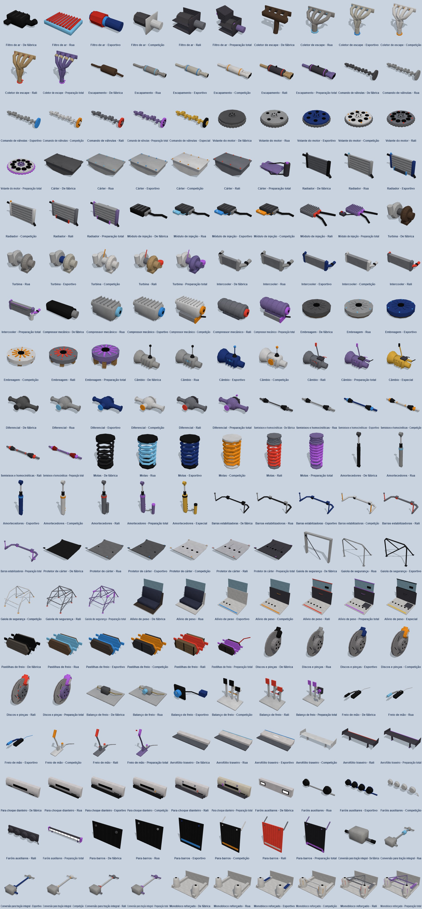

**Scitizia 64-bit parts** is a free collection of low-poly car parts with the retro look of 64-bit consoles, ready for real-time racing and garage games: **31 part types** (engine, turbo, transmission, suspension, brakes, bodywork and conversions), each in up to seven levels, from the stock factory part to the full rally build, plus 4 special prize parts. There are **190 files** in binary glTF 2.0 (`.glb`), from 6.1 to 107.1 KB, with 24 to 1,480 triangles (414 on average), vertex colors and 64×64 px textures with "nearest" filtering. The parts are the same ones from the garage of the game **Scitizia Rally Championship**, with no real brands.

## Summary

| | |
|---|---|
| Models | 190: 31 part types × levels (stock, n1 to n5) + 4 special |
| Format | Binary glTF 2.0 (`.glb`), textures also as PNG |
| Triangles | 24 to 1,480 per part (average 414) |
| Size | 6.1 to 107.1 KB per file, with the textures embedded |
| Levels | Stock (`fabrica`), Street (`n1`), Sport (`n2`), Competition (`n3`), Rally (`n4`), Full build (`n5`), Special (`especial`) |
| Materials | matte, gloss, carbon, rubber and light; the color comes from vertex color and the textures (4, 64×64 px, grayscale) add the grain |
| Scale and axes | meters, Y up, centered on X/Z, base at y = 0 |
| Machine-readable catalog | [`catalogo.json`](catalogo.json) |
| License | public domain, [CC0 1.0](LICENSE) |

## Engine: intake and exhaust

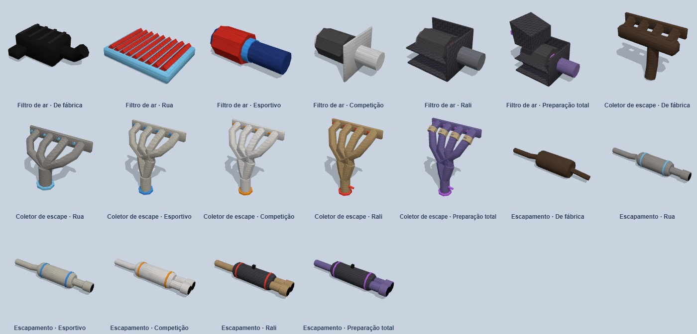

### Air filter

| Preview | Level | Part | Triangles | Dimensions | Size |
|---|---|---|---|---|---|
| 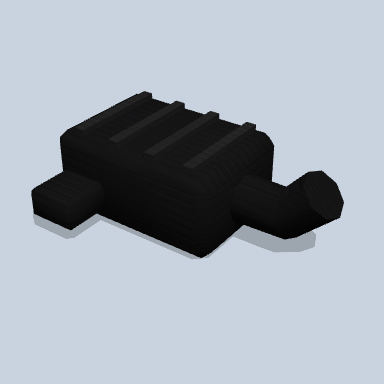 | Stock<br>`fabrica` | **Stock air filter**<br>[`filtro_ar_fabrica.glb`](modelos/filtro_ar/filtro_ar_fabrica.glb) | 180 | 52 cm × 17 cm × 33 cm | 14.8 KB |
| 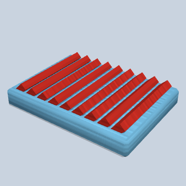 | Street<br>`n1` | **Sport panel filter**<br>[`filtro_ar_n1.glb`](modelos/filtro_ar/filtro_ar_n1.glb) | 152 | 30 cm × 6 cm × 22 cm | 15.3 KB |
| 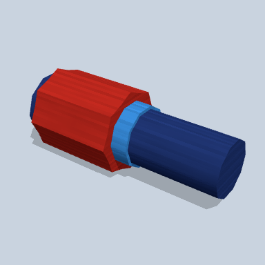 | Sport<br>`n2` | **Washable high-flow filter**<br>[`filtro_ar_n2.glb`](modelos/filtro_ar/filtro_ar_n2.glb) | 180 | 37 cm × 15 cm × 15 cm | 14.1 KB |
| 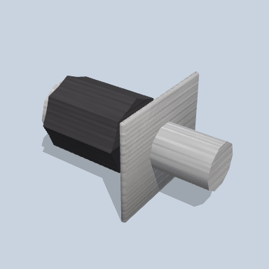 | Competition<br>`n3` | **Conical filter with cold air intake**<br>[`filtro_ar_n3.glb`](modelos/filtro_ar/filtro_ar_n3.glb) | 224 | 39 cm × 22 cm × 26 cm | 17.4 KB |
| 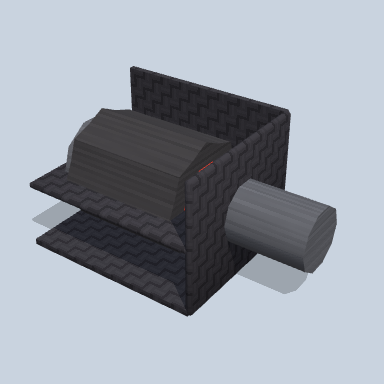 | Rally<br>`n4` | **Sealed airbox**<br>[`filtro_ar_n4.glb`](modelos/filtro_ar/filtro_ar_n4.glb) | 292 | 43 cm × 22 cm × 26 cm | 23.2 KB |
| 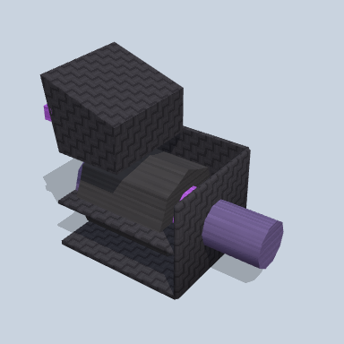 | Full build<br>`n5` | **Competition intake with ram-air scoop**<br>[`filtro_ar_n5.glb`](modelos/filtro_ar/filtro_ar_n5.glb) | 316 | 46 cm × 38 cm × 26 cm | 25.3 KB |

### Exhaust header

| Preview | Level | Part | Triangles | Dimensions | Size |
|---|---|---|---|---|---|
| 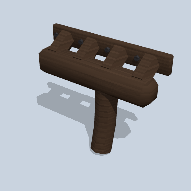 | Stock<br>`fabrica` | **Stock exhaust header**<br>[`coletor_escape_fabrica.glb`](modelos/coletor_escape/coletor_escape_fabrica.glb) | 308 | 42 cm × 34 cm × 15 cm | 23.3 KB |
| 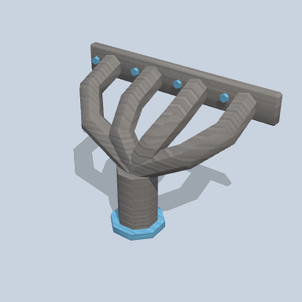 | Street<br>`n1` | **Tuned 4-into-1 header**<br>[`coletor_escape_n1.glb`](modelos/coletor_escape/coletor_escape_n1.glb) | 412 | 42 cm × 29 cm × 19 cm | 29.9 KB |
| 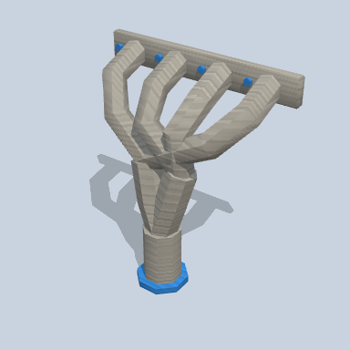 | Sport<br>`n2` | **4-2-1 header**<br>[`coletor_escape_n2.glb`](modelos/coletor_escape/coletor_escape_n2.glb) | 488 | 42 cm × 46 cm × 19 cm | 34.4 KB |
| 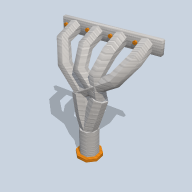 | Competition<br>`n3` | **Stainless steel 4-2-1 header**<br>[`coletor_escape_n3.glb`](modelos/coletor_escape/coletor_escape_n3.glb) | 488 | 42 cm × 49 cm × 19 cm | 34.6 KB |
| 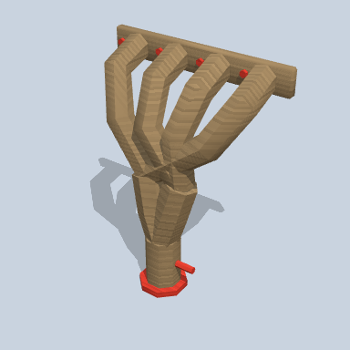 | Rally<br>`n4` | **Stainless steel competition header**<br>[`coletor_escape_n4.glb`](modelos/coletor_escape/coletor_escape_n4.glb) | 512 | 42 cm × 52 cm × 19 cm | 36.1 KB |
| 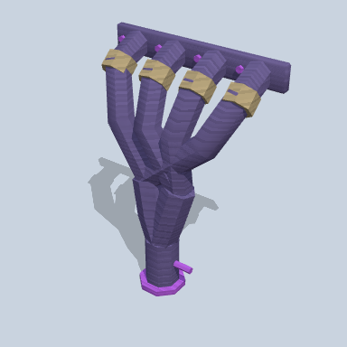 | Full build<br>`n5` | **Long-tube competition header**<br>[`coletor_escape_n5.glb`](modelos/coletor_escape/coletor_escape_n5.glb) | 608 | 42 cm × 55 cm × 19 cm | 44.1 KB |

### Exhaust system

| Preview | Level | Part | Triangles | Dimensions | Size |
|---|---|---|---|---|---|
| 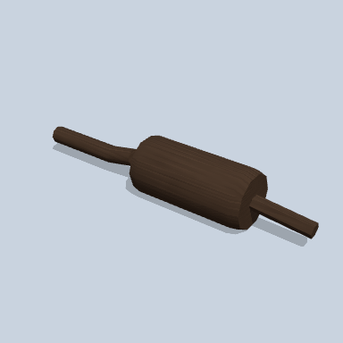 | Stock<br>`fabrica` | **Stock exhaust system**<br>[`escape_fabrica.glb`](modelos/escape/escape_fabrica.glb) | 144 | 1.00 m × 19 cm × 20 cm | 11.4 KB |
| 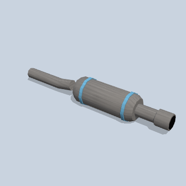 | Street<br>`n1` | **Sport exhaust (straight-through muffler)**<br>[`escape_n1.glb`](modelos/escape/escape_n1.glb) | 284 | 1.00 m × 16 cm × 17 cm | 19.0 KB |
| 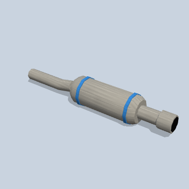 | Sport<br>`n2` | **Tuned exhaust system**<br>[`escape_n2.glb`](modelos/escape/escape_n2.glb) | 284 | 1.02 m × 18 cm × 18 cm | 19.0 KB |
| 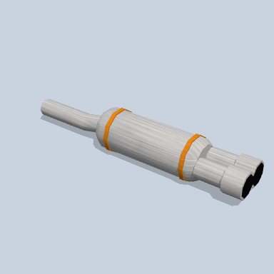 | Competition<br>`n3` | **Stainless steel tuned exhaust system**<br>[`escape_n3.glb`](modelos/escape/escape_n3.glb) | 364 | 1.04 m × 19 cm × 20 cm | 24.7 KB |
| 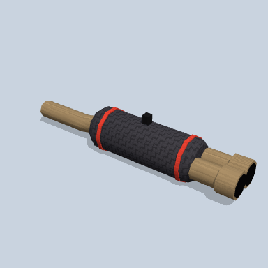 | Rally<br>`n4` | **Competition exhaust system**<br>[`escape_n4.glb`](modelos/escape/escape_n4.glb) | 376 | 1.06 m × 24 cm × 21 cm | 31.2 KB |
| 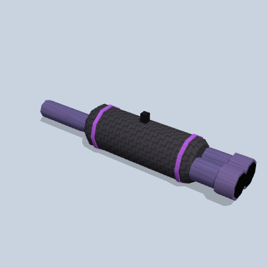 | Full build<br>`n5` | **Titanium competition exhaust system**<br>[`escape_n5.glb`](modelos/escape/escape_n5.glb) | 376 | 1.08 m × 25 cm × 22 cm | 31.2 KB |

## Engine: internal tuning

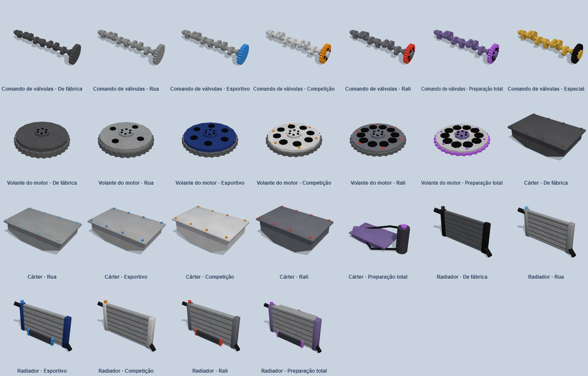

### Camshaft

| Preview | Level | Part | Triangles | Dimensions | Size |
|---|---|---|---|---|---|
| 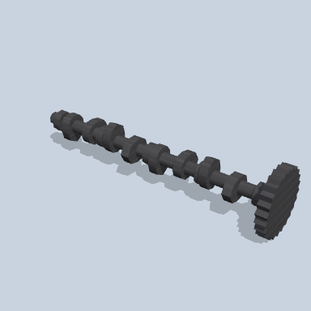 | Stock<br>`fabrica` | **Stock camshaft**<br>[`comando_fabrica.glb`](modelos/comando/comando_fabrica.glb) | 704 | 48 cm × 12 cm × 12 cm | 45.7 KB |
|  | Street<br>`n1` | **Street camshaft (mild profile)**<br>[`comando_n1.glb`](modelos/comando/comando_n1.glb) | 704 | 48 cm × 12 cm × 12 cm | 45.6 KB |
| 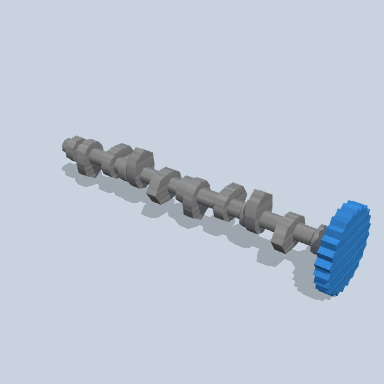 | Sport<br>`n2` | **Sport camshaft**<br>[`comando_n2.glb`](modelos/comando/comando_n2.glb) | 704 | 48 cm × 12 cm × 12 cm | 45.6 KB |
| 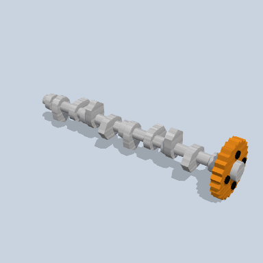 | Competition<br>`n3` | **Aggressive camshaft**<br>[`comando_n3.glb`](modelos/comando/comando_n3.glb) | 832 | 49 cm × 12 cm × 12 cm | 55.1 KB |
| 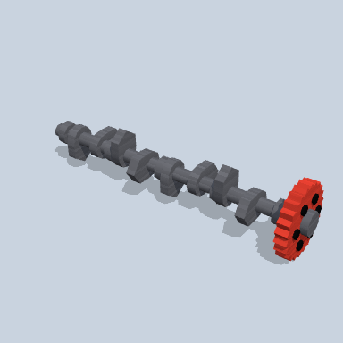 | Rally<br>`n4` | **Competition camshaft**<br>[`comando_n4.glb`](modelos/comando/comando_n4.glb) | 880 | 49 cm × 12 cm × 12 cm | 58.3 KB |
| 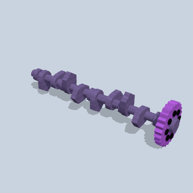 | Full build<br>`n5` | **High-duration camshaft**<br>[`comando_n5.glb`](modelos/comando/comando_n5.glb) | 928 | 49 cm × 12 cm × 12 cm | 61.6 KB |
| 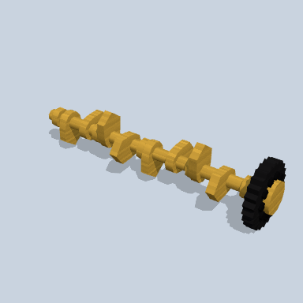 | Special<br>`especial` | **Special series camshaft (prize)**<br>[`comando_especial.glb`](modelos/comando/comando_especial.glb) | 1,016 | 49 cm × 12 cm × 12 cm | 67.0 KB |

### Flywheel

| Preview | Level | Part | Triangles | Dimensions | Size |
|---|---|---|---|---|---|
| 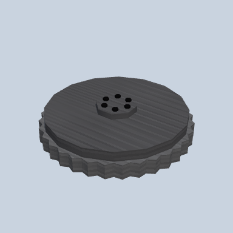 | Stock<br>`fabrica` | **Stock flywheel**<br>[`volante_motor_fabrica.glb`](modelos/volante_motor/volante_motor_fabrica.glb) | 496 | 30 cm × 7 cm × 30 cm | 34.5 KB |
| 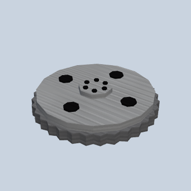 | Street<br>`n1` | **Lightened flywheel**<br>[`volante_motor_n1.glb`](modelos/volante_motor/volante_motor_n1.glb) | 624 | 30 cm × 6 cm × 30 cm | 41.8 KB |
| 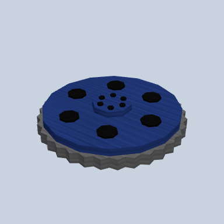 | Sport<br>`n2` | **Lightweight steel flywheel**<br>[`volante_motor_n2.glb`](modelos/volante_motor/volante_motor_n2.glb) | 688 | 30 cm × 5 cm × 30 cm | 45.4 KB |
| 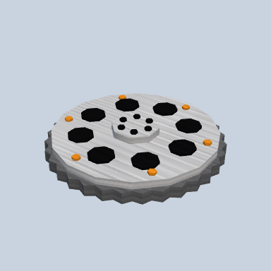 | Competition<br>`n3` | **Balanced lightweight steel flywheel**<br>[`volante_motor_n3.glb`](modelos/volante_motor/volante_motor_n3.glb) | 896 | 30 cm × 5 cm × 30 cm | 59.9 KB |
| 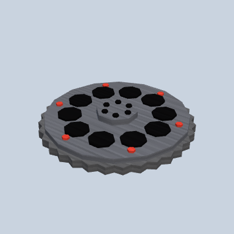 | Rally<br>`n4` | **Chromoly flywheel**<br>[`volante_motor_n4.glb`](modelos/volante_motor/volante_motor_n4.glb) | 960 | 30 cm × 4 cm × 30 cm | 63.6 KB |
| 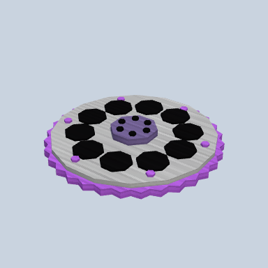 | Full build<br>`n5` | **Aluminum competition flywheel**<br>[`volante_motor_n5.glb`](modelos/volante_motor/volante_motor_n5.glb) | 960 | 30 cm × 4 cm × 30 cm | 63.6 KB |

### Oil pan

| Preview | Level | Part | Triangles | Dimensions | Size |
|---|---|---|---|---|---|
| 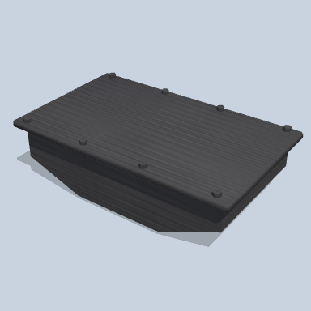 | Stock<br>`fabrica` | **Stock oil pan**<br>[`carter_fabrica.glb`](modelos/carter/carter_fabrica.glb) | 280 | 50 cm × 15 cm × 30 cm | 22.1 KB |
| 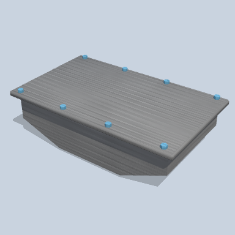 | Street<br>`n1` | **Baffled oil pan**<br>[`carter_n1.glb`](modelos/carter/carter_n1.glb) | 280 | 50 cm × 15 cm × 30 cm | 22.1 KB |
| 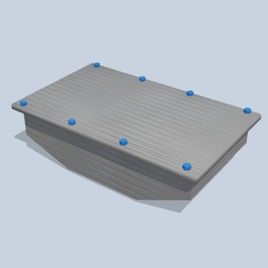 | Sport<br>`n2` | **Finned baffled oil pan**<br>[`carter_n2.glb`](modelos/carter/carter_n2.glb) | 340 | 50 cm × 15 cm × 30 cm | 27.2 KB |
| 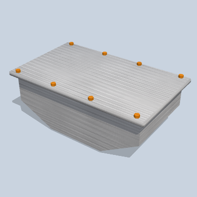 | Competition<br>`n3` | **Extended oil pan with trap doors**<br>[`carter_n3.glb`](modelos/carter/carter_n3.glb) | 352 | 50 cm × 19 cm × 30 cm | 28.3 KB |
| 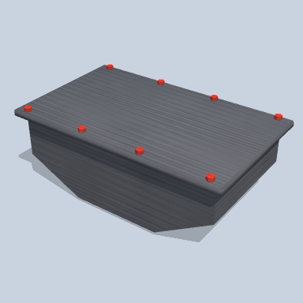 | Rally<br>`n4` | **Competition oil pan with trap doors**<br>[`carter_n4.glb`](modelos/carter/carter_n4.glb) | 364 | 50 cm × 19 cm × 30 cm | 29.3 KB |
| 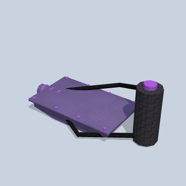 | Full build<br>`n5` | **Dry sump oil pan**<br>[`carter_n5.glb`](modelos/carter/carter_n5.glb) | 628 | 72 cm × 31 cm × 38 cm | 50.9 KB |

### Radiator

| Preview | Level | Part | Triangles | Dimensions | Size |
|---|---|---|---|---|---|
| 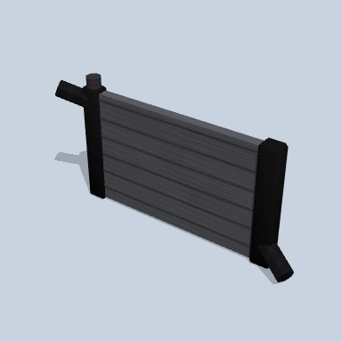 | Stock<br>`fabrica` | **Stock radiator**<br>[`radiador_fabrica.glb`](modelos/radiador/radiador_fabrica.glb) | 252 | 77 cm × 39 cm × 10 cm | 24.5 KB |
| 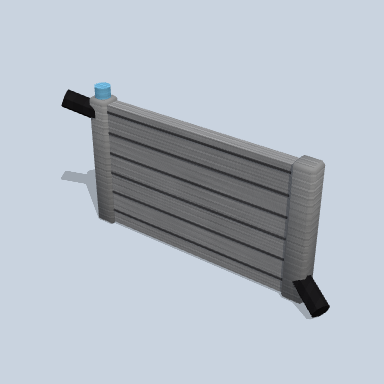 | Street<br>`n1` | **Aluminum radiator**<br>[`radiador_n1.glb`](modelos/radiador/radiador_n1.glb) | 252 | 81 cm × 41 cm × 10 cm | 24.5 KB |
| 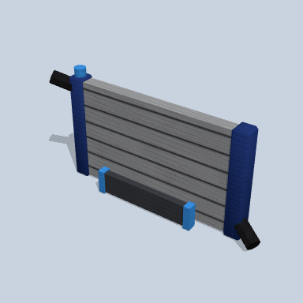 | Sport<br>`n2` | **Aluminum radiator with oil cooler**<br>[`radiador_n2.glb`](modelos/radiador/radiador_n2.glb) | 288 | 85 cm × 43 cm × 11 cm | 27.5 KB |
| 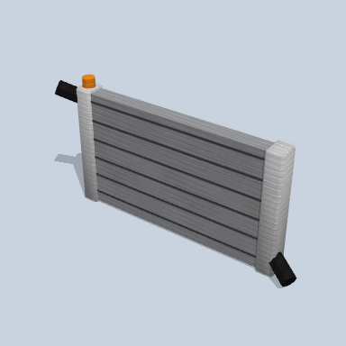 | Competition<br>`n3` | **High-capacity radiator**<br>[`radiador_n3.glb`](modelos/radiador/radiador_n3.glb) | 252 | 89 cm × 45 cm × 11 cm | 25.6 KB |
| 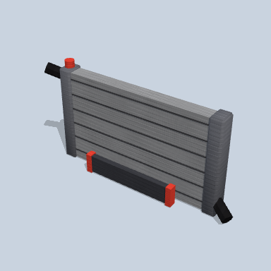 | Rally<br>`n4` | **High-capacity radiator with oil cooler**<br>[`radiador_n4.glb`](modelos/radiador/radiador_n4.glb) | 288 | 93 cm × 47 cm × 13 cm | 28.6 KB |
| 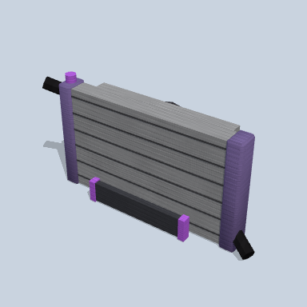 | Full build<br>`n5` | **Competition cooling system (dual radiator and electric fan)**<br>[`radiador_n5.glb`](modelos/radiador/radiador_n5.glb) | 416 | 93 cm × 47 cm × 24 cm | 39.3 KB |

## Engine: electronic fuel injection

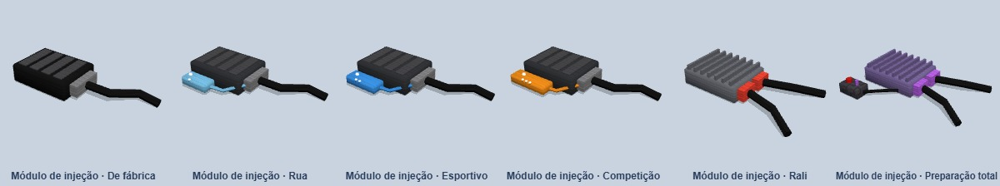

### Engine control unit

| Preview | Level | Part | Triangles | Dimensions | Size |
|---|---|---|---|---|---|
| 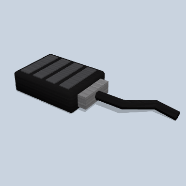 | Stock<br>`fabrica` | **Stock engine control unit**<br>[`ecu_fabrica.glb`](modelos/ecu/ecu_fabrica.glb) | 148 | 42 cm × 6 cm × 15 cm | 14.2 KB |
| 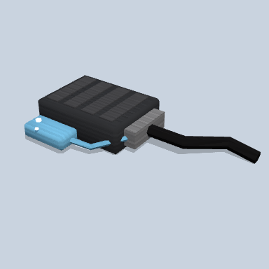 | Street<br>`n1` | **Remap (stage 1)**<br>[`ecu_n1.glb`](modelos/ecu/ecu_n1.glb) | 262 | 42 cm × 6 cm × 21 cm | 24.1 KB |
| 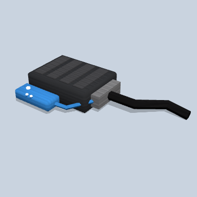 | Sport<br>`n2` | **Remap (stage 2)**<br>[`ecu_n2.glb`](modelos/ecu/ecu_n2.glb) | 282 | 42 cm × 6 cm × 21 cm | 25.4 KB |
| 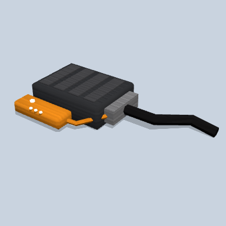 | Competition<br>`n3` | **Remap (stage 3)**<br>[`ecu_n3.glb`](modelos/ecu/ecu_n3.glb) | 302 | 42 cm × 6 cm × 21 cm | 27.9 KB |
|  | Rally<br>`n4` | **Programmable ECU**<br>[`ecu_n4.glb`](modelos/ecu/ecu_n4.glb) | 216 | 44 cm × 8 cm × 26 cm | 20.5 KB |
|  | Full build<br>`n5` | **Programmable ECU with launch control**<br>[`ecu_n5.glb`](modelos/ecu/ecu_n5.glb) | 342 | 45 cm × 8 cm × 33 cm | 29.5 KB |

## Turbo and supercharger


### Turbocharger

| Preview | Level | Part | Triangles | Dimensions | Size |
|---|---|---|---|---|---|
|  | Stock<br>`fabrica` | **Stock turbocharger**<br>[`turbo_fabrica.glb`](modelos/turbo/turbo_fabrica.glb) | 668 | 30 cm × 21 cm × 25 cm | 42.9 KB |
|  | Street<br>`n1` | **Recalibrated turbocharger (more boost)**<br>[`turbo_n1.glb`](modelos/turbo/turbo_n1.glb) | 668 | 33 cm × 23 cm × 27 cm | 42.9 KB |
|  | Sport<br>`n2` | **Larger ball-bearing turbocharger**<br>[`turbo_n2.glb`](modelos/turbo/turbo_n2.glb) | 668 | 35 cm × 24 cm × 29 cm | 42.9 KB |
|  | Competition<br>`n3` | **High-flow turbocharger**<br>[`turbo_n3.glb`](modelos/turbo/turbo_n3.glb) | 684 | 38 cm × 29 cm × 31 cm | 44.1 KB |
|  | Rally<br>`n4` | **High-flow turbocharger with external wastegate**<br>[`turbo_n4.glb`](modelos/turbo/turbo_n4.glb) | 732 | 40 cm × 31 cm × 35 cm | 46.8 KB |
|  | Full build<br>`n5` | **Twin-scroll turbocharger**<br>[`turbo_n5.glb`](modelos/turbo/turbo_n5.glb) | 744 | 43 cm × 33 cm × 37 cm | 47.8 KB |

### Intercooler

| Preview | Level | Part | Triangles | Dimensions | Size |
|---|---|---|---|---|---|
|  | Stock<br>`fabrica` | **Stock intercooler**<br>[`intercooler_fabrica.glb`](modelos/intercooler/intercooler_fabrica.glb) | 272 | 64 cm × 20 cm × 20 cm | 26.6 KB |
|  | Street<br>`n1` | **Larger intercooler**<br>[`intercooler_n1.glb`](modelos/intercooler/intercooler_n1.glb) | 272 | 70 cm × 22 cm × 20 cm | 26.6 KB |
|  | Sport<br>`n2` | **Front-mount intercooler**<br>[`intercooler_n2.glb`](modelos/intercooler/intercooler_n2.glb) | 272 | 90 cm × 24 cm × 20 cm | 26.6 KB |
|  | Competition<br>`n3` | **Thick-core front-mount intercooler**<br>[`intercooler_n3.glb`](modelos/intercooler/intercooler_n3.glb) | 272 | 94 cm × 26 cm × 22 cm | 27.7 KB |
|  | Rally<br>`n4` | **Competition front-mount intercooler**<br>[`intercooler_n4.glb`](modelos/intercooler/intercooler_n4.glb) | 272 | 98 cm × 27 cm × 22 cm | 27.7 KB |
|  | Full build<br>`n5` | **Front-mount intercooler with water spray**<br>[`intercooler_n5.glb`](modelos/intercooler/intercooler_n5.glb) | 456 | 100 cm × 29 cm × 32 cm | 39.5 KB |

### Supercharger

| Preview | Level | Part | Triangles | Dimensions | Size |
|---|---|---|---|---|---|
|  | Stock<br>`fabrica` | **Stock supercharger**<br>[`compressor_fabrica.glb`](modelos/compressor/compressor_fabrica.glb) | 164 | 41 cm × 12 cm × 22 cm | 14.5 KB |
|  | Street<br>`n1` | **Low-pressure lobe supercharger**<br>[`compressor_n1.glb`](modelos/compressor/compressor_n1.glb) | 248 | 38 cm × 21 cm × 18 cm | 19.9 KB |
|  | Sport<br>`n2` | **Lobe supercharger**<br>[`compressor_n2.glb`](modelos/compressor/compressor_n2.glb) | 260 | 42 cm × 21 cm × 18 cm | 20.9 KB |
|  | Competition<br>`n3` | **Lobe supercharger with intercooler**<br>[`compressor_n3.glb`](modelos/compressor/compressor_n3.glb) | 312 | 46 cm × 28 cm × 22 cm | 30.0 KB |
|  | Rally<br>`n4` | **Screw supercharger**<br>[`compressor_n4.glb`](modelos/compressor/compressor_n4.glb) | 468 | 50 cm × 22 cm × 20 cm | 29.6 KB |
|  | Full build<br>`n5` | **Screw supercharger with intercooler**<br>[`compressor_n5.glb`](modelos/compressor/compressor_n5.glb) | 508 | 50 cm × 29 cm × 23 cm | 36.6 KB |

## Transmission


### Clutch

| Preview | Level | Part | Triangles | Dimensions | Size |
|---|---|---|---|---|---|
|  | Stock<br>`fabrica` | **Stock clutch**<br>[`embreagem_fabrica.glb`](modelos/embreagem/embreagem_fabrica.glb) | 584 | 25 cm × 8 cm × 25 cm | 43.0 KB |
|  | Street<br>`n1` | **Reinforced clutch (organic disc)**<br>[`embreagem_n1.glb`](modelos/embreagem/embreagem_n1.glb) | 632 | 25 cm × 8 cm × 25 cm | 46.2 KB |
|  | Sport<br>`n2` | **Reinforced pressure plate clutch**<br>[`embreagem_n2.glb`](modelos/embreagem/embreagem_n2.glb) | 632 | 25 cm × 8 cm × 25 cm | 46.2 KB |
|  | Competition<br>`n3` | **Cerametallic clutch**<br>[`embreagem_n3.glb`](modelos/embreagem/embreagem_n3.glb) | 688 | 25 cm × 8 cm × 25 cm | 52.5 KB |
|  | Rally<br>`n4` | **Twin-disc cerametallic clutch**<br>[`embreagem_n4.glb`](modelos/embreagem/embreagem_n4.glb) | 952 | 25 cm × 9 cm × 25 cm | 70.7 KB |
|  | Full build<br>`n5` | **Competition multi-plate clutch**<br>[`embreagem_n5.glb`](modelos/embreagem/embreagem_n5.glb) | 1,480 | 20 cm × 12 cm × 20 cm | 107.1 KB |

### Gearbox

| Preview | Level | Part | Triangles | Dimensions | Size |
|---|---|---|---|---|---|
|  | Stock<br>`fabrica` | **Stock gearbox**<br>[`cambio_fabrica.glb`](modelos/cambio/cambio_fabrica.glb) | 276 | 57 cm × 58 cm × 35 cm | 24.1 KB |
|  | Street<br>`n1` | **Gearbox with shorter ratios**<br>[`cambio_n1.glb`](modelos/cambio/cambio_n1.glb) | 288 | 57 cm × 55 cm × 35 cm | 25.1 KB |
|  | Sport<br>`n2` | **Close-ratio gearbox**<br>[`cambio_n2.glb`](modelos/cambio/cambio_n2.glb) | 288 | 57 cm × 52 cm × 35 cm | 25.1 KB |
|  | Competition<br>`n3` | **Straight-cut gearbox**<br>[`cambio_n3.glb`](modelos/cambio/cambio_n3.glb) | 432 | 57 cm × 49 cm × 35 cm | 35.6 KB |
|  | Rally<br>`n4` | **Straight-cut sequential gearbox**<br>[`cambio_n4.glb`](modelos/cambio/cambio_n4.glb) | 494 | 57 cm × 62 cm × 35 cm | 36.7 KB |
|  | Full build<br>`n5` | **Sequential gearbox with paddle shifters**<br>[`cambio_n5.glb`](modelos/cambio/cambio_n5.glb) | 542 | 61 cm × 62 cm × 38 cm | 43.5 KB |
|  | Special<br>`especial` | **Reinforced quick-shift gearbox (prize)**<br>[`cambio_especial.glb`](modelos/cambio/cambio_especial.glb) | 542 | 61 cm × 62 cm × 38 cm | 43.5 KB |

### Differential

| Preview | Level | Part | Triangles | Dimensions | Size |
|---|---|---|---|---|---|
|  | Stock<br>`fabrica` | **Stock differential**<br>[`diferencial_fabrica.glb`](modelos/diferencial/diferencial_fabrica.glb) | 584 | 59 cm × 24 cm × 29 cm | 37.4 KB |
|  | Street<br>`n1` | **Viscous limited-slip differential**<br>[`diferencial_n1.glb`](modelos/diferencial/diferencial_n1.glb) | 584 | 59 cm × 24 cm × 29 cm | 37.4 KB |
|  | Sport<br>`n2` | **1-way mechanical limited-slip differential**<br>[`diferencial_n2.glb`](modelos/diferencial/diferencial_n2.glb) | 620 | 59 cm × 24 cm × 30 cm | 40.4 KB |
|  | Competition<br>`n3` | **1.5-way mechanical limited-slip differential**<br>[`diferencial_n3.glb`](modelos/diferencial/diferencial_n3.glb) | 632 | 59 cm × 24 cm × 30 cm | 41.4 KB |
|  | Rally<br>`n4` | **2-way limited-slip differential**<br>[`diferencial_n4.glb`](modelos/diferencial/diferencial_n4.glb) | 644 | 59 cm × 24 cm × 30 cm | 44.2 KB |
|  | Full build<br>`n5` | **2-way limited-slip differential with adjustable ramps**<br>[`diferencial_n5.glb`](modelos/diferencial/diferencial_n5.glb) | 688 | 59 cm × 25 cm × 33 cm | 47.0 KB |

### Driveshafts and CV joints

| Preview | Level | Part | Triangles | Dimensions | Size |
|---|---|---|---|---|---|
|  | Stock<br>`fabrica` | **Stock driveshafts and CV joints**<br>[`semieixos_fabrica.glb`](modelos/semieixos/semieixos_fabrica.glb) | 616 | 94 cm × 12 cm × 12 cm | 45.1 KB |
|  | Street<br>`n1` | **Reinforced CV joints**<br>[`semieixos_n1.glb`](modelos/semieixos/semieixos_n1.glb) | 616 | 94 cm × 12 cm × 12 cm | 45.1 KB |
|  | Sport<br>`n2` | **Reinforced driveshafts**<br>[`semieixos_n2.glb`](modelos/semieixos/semieixos_n2.glb) | 616 | 94 cm × 12 cm × 12 cm | 45.1 KB |
|  | Competition<br>`n3` | **Treated driveshafts with reinforced CV joints**<br>[`semieixos_n3.glb`](modelos/semieixos/semieixos_n3.glb) | 680 | 94 cm × 12 cm × 12 cm | 49.9 KB |
|  | Rally<br>`n4` | **Chromoly driveshafts**<br>[`semieixos_n4.glb`](modelos/semieixos/semieixos_n4.glb) | 680 | 94 cm × 12 cm × 12 cm | 49.9 KB |
|  | Full build<br>`n5` | **Competition driveshafts with rally CV joints**<br>[`semieixos_n5.glb`](modelos/semieixos/semieixos_n5.glb) | 680 | 94 cm × 12 cm × 12 cm | 49.9 KB |

## Suspension and chassis


### Springs

| Preview | Level | Part | Triangles | Dimensions | Size |
|---|---|---|---|---|---|
|  | Stock<br>`fabrica` | **Stock springs**<br>[`molas_fabrica.glb`](modelos/molas/molas_fabrica.glb) | 566 | 15 cm × 26 cm × 15 cm | 36.6 KB |
|  | Street<br>`n1` | **Sport springs**<br>[`molas_n1.glb`](modelos/molas/molas_n1.glb) | 566 | 15 cm × 24 cm × 15 cm | 36.6 KB |
|  | Sport<br>`n2` | **Competition springs**<br>[`molas_n2.glb`](modelos/molas/molas_n2.glb) | 606 | 15 cm × 24 cm × 15 cm | 38.7 KB |
|  | Competition<br>`n3` | **Rally springs**<br>[`molas_n3.glb`](modelos/molas/molas_n3.glb) | 646 | 15 cm × 26 cm × 15 cm | 41.0 KB |
|  | Rally<br>`n4` | **Long-travel rally springs**<br>[`molas_n4.glb`](modelos/molas/molas_n4.glb) | 932 | 15 cm × 36 cm × 15 cm | 57.4 KB |
|  | Full build<br>`n5` | **Progressive rally springs**<br>[`molas_n5.glb`](modelos/molas/molas_n5.glb) | 1,012 | 15 cm × 38 cm × 15 cm | 61.9 KB |

### Shock absorbers

| Preview | Level | Part | Triangles | Dimensions | Size |
|---|---|---|---|---|---|
|  | Stock<br>`fabrica` | **Stock shock absorbers**<br>[`amortecedores_fabrica.glb`](modelos/amortecedores/amortecedores_fabrica.glb) | 180 | 5 cm × 53 cm × 5 cm | 19.8 KB |
|  | Street<br>`n1` | **Pressurized shock absorbers**<br>[`amortecedores_n1.glb`](modelos/amortecedores/amortecedores_n1.glb) | 220 | 6 cm × 53 cm × 6 cm | 21.9 KB |
|  | Sport<br>`n2` | **1-way adjustable shock absorbers**<br>[`amortecedores_n2.glb`](modelos/amortecedores/amortecedores_n2.glb) | 252 | 7 cm × 53 cm × 8 cm | 23.8 KB |
|  | Competition<br>`n3` | **2-way shock absorbers**<br>[`amortecedores_n3.glb`](modelos/amortecedores/amortecedores_n3.glb) | 284 | 7 cm × 53 cm × 9 cm | 24.5 KB |
|  | Rally<br>`n4` | **2-way shock absorbers with reservoir**<br>[`amortecedores_n4.glb`](modelos/amortecedores/amortecedores_n4.glb) | 336 | 12 cm × 53 cm × 9 cm | 27.7 KB |
|  | Full build<br>`n5` | **3-way rally shock absorbers**<br>[`amortecedores_n5.glb`](modelos/amortecedores/amortecedores_n5.glb) | 432 | 22 cm × 53 cm × 13 cm | 34.4 KB |
|  | Special<br>`especial` | **Shock absorbers with custom valving (prize)**<br>[`amortecedores_especial.glb`](modelos/amortecedores/amortecedores_especial.glb) | 432 | 22 cm × 53 cm × 13 cm | 34.4 KB |

### Anti-roll bars

| Preview | Level | Part | Triangles | Dimensions | Size |
|---|---|---|---|---|---|
|  | Stock<br>`fabrica` | **Stock anti-roll bars**<br>[`barras_fabrica.glb`](modelos/barras/barras_fabrica.glb) | 284 | 65 cm × 20 cm × 26 cm | 24.2 KB |
|  | Street<br>`n1` | **Thicker bars**<br>[`barras_n1.glb`](modelos/barras/barras_n1.glb) | 284 | 65 cm × 20 cm × 26 cm | 24.1 KB |
|  | Sport<br>`n2` | **Adjustable bars**<br>[`barras_n2.glb`](modelos/barras/barras_n2.glb) | 452 | 65 cm × 20 cm × 27 cm | 35.9 KB |
|  | Competition<br>`n3` | **Tubular adjustable bars**<br>[`barras_n3.glb`](modelos/barras/barras_n3.glb) | 452 | 65 cm × 20 cm × 27 cm | 37.0 KB |
|  | Rally<br>`n4` | **Tubular bars with competition bushings**<br>[`barras_n4.glb`](modelos/barras/barras_n4.glb) | 452 | 65 cm × 20 cm × 27 cm | 33.3 KB |
|  | Full build<br>`n5` | **Quick-adjust bars**<br>[`barras_n5.glb`](modelos/barras/barras_n5.glb) | 516 | 68 cm × 20 cm × 27 cm | 37.0 KB |

### Skid plate

| Preview | Level | Part | Triangles | Dimensions | Size |
|---|---|---|---|---|---|
|  | Stock<br>`fabrica` | **Stock skid plate**<br>[`protetor_fabrica.glb`](modelos/protetor/protetor_fabrica.glb) | 180 | 70 cm × 16 cm × 83 cm | 17.7 KB |
|  | Street<br>`n1` | **Steel skid plate**<br>[`protetor_n1.glb`](modelos/protetor/protetor_n1.glb) | 244 | 70 cm × 16 cm × 83 cm | 21.3 KB |
|  | Sport<br>`n2` | **Thick steel skid plate**<br>[`protetor_n2.glb`](modelos/protetor/protetor_n2.glb) | 244 | 70 cm × 16 cm × 83 cm | 21.3 KB |
|  | Competition<br>`n3` | **Aluminum skid plate**<br>[`protetor_n3.glb`](modelos/protetor/protetor_n3.glb) | 308 | 70 cm × 16 cm × 83 cm | 26.1 KB |
|  | Rally<br>`n4` | **Thick aluminum skid plate**<br>[`protetor_n4.glb`](modelos/protetor/protetor_n4.glb) | 332 | 70 cm × 16 cm × 83 cm | 28.1 KB |
|  | Full build<br>`n5` | **Composite skid plate**<br>[`protetor_n5.glb`](modelos/protetor/protetor_n5.glb) | 396 | 70 cm × 16 cm × 83 cm | 33.5 KB |

### Roll cage

| Preview | Level | Part | Triangles | Dimensions | Size |
|---|---|---|---|---|---|
|  | Stock<br>`fabrica` | **Stock roll cage**<br>[`gaiola_fabrica.glb`](modelos/gaiola/gaiola_fabrica.glb) | 68 | 1.26 m × 1.08 m × 19 cm | 13.2 KB |
|  | Street<br>`n1` | **Bolt-in roll bar**<br>[`gaiola_n1.glb`](modelos/gaiola/gaiola_n1.glb) | 564 | 1.30 m × 1.08 m × 1.00 m | 41.6 KB |
|  | Sport<br>`n2` | **Bolt-in 4-point cage**<br>[`gaiola_n2.glb`](modelos/gaiola/gaiola_n2.glb) | 584 | 1.30 m × 1.08 m × 1.00 m | 43.1 KB |
|  | Competition<br>`n3` | **Bolt-in 6-point cage**<br>[`gaiola_n3.glb`](modelos/gaiola/gaiola_n3.glb) | 908 | 1.30 m × 1.09 m × 2.30 m | 65.2 KB |
|  | Rally<br>`n4` | **Welded multi-point cage**<br>[`gaiola_n4.glb`](modelos/gaiola/gaiola_n4.glb) | 452 | 1.30 m × 1.09 m × 2.30 m | 35.4 KB |
|  | Full build<br>`n5` | **Integrated chromoly cage**<br>[`gaiola_n5.glb`](modelos/gaiola/gaiola_n5.glb) | 596 | 1.30 m × 1.09 m × 2.30 m | 44.2 KB |

### Weight reduction kit

| Preview | Level | Part | Triangles | Dimensions | Size |
|---|---|---|---|---|---|
|  | Stock<br>`fabrica` | **Stock weight reduction kit**<br>[`reducao_peso_fabrica.glb`](modelos/reducao_peso/reducao_peso_fabrica.glb) | 148 | 1.00 m × 97 cm × 73 cm | 15.0 KB |
|  | Street<br>`n1` | **Stripped interior**<br>[`reducao_peso_n1.glb`](modelos/reducao_peso/reducao_peso_n1.glb) | 136 | 1.00 m × 97 cm × 73 cm | 14.0 KB |
|  | Sport<br>`n2` | **Rear seat and trim removed**<br>[`reducao_peso_n2.glb`](modelos/reducao_peso/reducao_peso_n2.glb) | 144 | 1.00 m × 97 cm × 73 cm | 14.7 KB |
|  | Competition<br>`n3` | **Fiber panels**<br>[`reducao_peso_n3.glb`](modelos/reducao_peso/reducao_peso_n3.glb) | 204 | 1.00 m × 97 cm × 73 cm | 20.6 KB |
|  | Rally<br>`n4` | **Polycarbonate windows**<br>[`reducao_peso_n4.glb`](modelos/reducao_peso/reducao_peso_n4.glb) | 272 | 1.00 m × 97 cm × 73 cm | 25.4 KB |
|  | Full build<br>`n5` | **Complete lightweight shell**<br>[`reducao_peso_n5.glb`](modelos/reducao_peso/reducao_peso_n5.glb) | 412 | 1.00 m × 97 cm × 73 cm | 34.8 KB |
|  | Special<br>`especial` | **Weight reduction with reinforcement in the right places (prize)**<br>[`reducao_peso_especial.glb`](modelos/reducao_peso/reducao_peso_especial.glb) | 412 | 1.00 m × 97 cm × 73 cm | 34.8 KB |

## Brakes


### Brake pads

| Preview | Level | Part | Triangles | Dimensions | Size |
|---|---|---|---|---|---|
|  | Stock<br>`fabrica` | **Stock brake pads**<br>[`pastilhas_fabrica.glb`](modelos/pastilhas/pastilhas_fabrica.glb) | 128 | 19 cm × 6 cm × 9 cm | 14.2 KB |
|  | Street<br>`n1` | **High-friction pads**<br>[`pastilhas_n1.glb`](modelos/pastilhas/pastilhas_n1.glb) | 128 | 19 cm × 6 cm × 9 cm | 14.2 KB |
|  | Sport<br>`n2` | **Sport pads**<br>[`pastilhas_n2.glb`](modelos/pastilhas/pastilhas_n2.glb) | 128 | 19 cm × 6 cm × 10 cm | 14.2 KB |
|  | Competition<br>`n3` | **Competition pads**<br>[`pastilhas_n3.glb`](modelos/pastilhas/pastilhas_n3.glb) | 152 | 19 cm × 6 cm × 10 cm | 17.3 KB |
|  | Rally<br>`n4` | **Competition gravel pads**<br>[`pastilhas_n4.glb`](modelos/pastilhas/pastilhas_n4.glb) | 200 | 19 cm × 6 cm × 11 cm | 21.4 KB |
|  | Full build<br>`n5` | **Rally pads (bite when cold)**<br>[`pastilhas_n5.glb`](modelos/pastilhas/pastilhas_n5.glb) | 172 | 24 cm × 13 cm × 11 cm | 18.9 KB |

### Discs and calipers

| Preview | Level | Part | Triangles | Dimensions | Size |
|---|---|---|---|---|---|
|  | Stock<br>`fabrica` | **Stock discs and calipers**<br>[`discos_fabrica.glb`](modelos/discos/discos_fabrica.glb) | 336 | 9 cm × 28 cm × 26 cm | 23.7 KB |
|  | Street<br>`n1` | **Slotted discs**<br>[`discos_n1.glb`](modelos/discos/discos_n1.glb) | 408 | 9 cm × 30 cm × 28 cm | 29.7 KB |
|  | Sport<br>`n2` | **Larger vented discs**<br>[`discos_n2.glb`](modelos/discos/discos_n2.glb) | 568 | 11 cm × 32 cm × 30 cm | 37.7 KB |
|  | Competition<br>`n3` | **Vented discs with 4-piston caliper**<br>[`discos_n3.glb`](modelos/discos/discos_n3.glb) | 604 | 11 cm × 35 cm × 33 cm | 41.4 KB |
|  | Rally<br>`n4` | **Floating discs with 4-piston caliper**<br>[`discos_n4.glb`](modelos/discos/discos_n4.glb) | 844 | 11 cm × 38 cm × 35 cm | 57.6 KB |
|  | Full build<br>`n5` | **Floating discs with 6-piston caliper**<br>[`discos_n5.glb`](modelos/discos/discos_n5.glb) | 844 | 11 cm × 41 cm × 38 cm | 57.7 KB |

### Brake bias

| Preview | Level | Part | Triangles | Dimensions | Size |
|---|---|---|---|---|---|
|  | Stock<br>`fabrica` | **Stock brake bias**<br>[`balanco_freio_fabrica.glb`](modelos/balanco_freio/balanco_freio_fabrica.glb) | 96 | 30 cm × 7 cm × 20 cm | 11.7 KB |
|  | Street<br>`n1` | **Proportioning valve on the floor**<br>[`balanco_freio_n1.glb`](modelos/balanco_freio/balanco_freio_n1.glb) | 136 | 30 cm × 7 cm × 20 cm | 13.9 KB |
|  | Sport<br>`n2` | **Proportioning valve on the dash**<br>[`balanco_freio_n2.glb`](modelos/balanco_freio/balanco_freio_n2.glb) | 142 | 23 cm × 12 cm × 22 cm | 12.8 KB |
|  | Competition<br>`n3` | **Pedal box with balance bar**<br>[`balanco_freio_n3.glb`](modelos/balanco_freio/balanco_freio_n3.glb) | 260 | 34 cm × 34 cm × 33 cm | 22.0 KB |
|  | Rally<br>`n4` | **Competition pedal box**<br>[`balanco_freio_n4.glb`](modelos/balanco_freio/balanco_freio_n4.glb) | 260 | 34 cm × 34 cm × 33 cm | 22.0 KB |
|  | Full build<br>`n5` | **Competition pedal box with dash-mounted adjustment**<br>[`balanco_freio_n5.glb`](modelos/balanco_freio/balanco_freio_n5.glb) | 332 | 43 cm × 38 cm × 37 cm | 28.2 KB |

### Handbrake

| Preview | Level | Part | Triangles | Dimensions | Size |
|---|---|---|---|---|---|
|  | Stock<br>`fabrica` | **Stock handbrake**<br>[`freio_mao_fabrica.glb`](modelos/freio_mao/freio_mao_fabrica.glb) | 184 | 13 cm × 17 cm × 78 cm | 19.0 KB |
|  | Street<br>`n1` | **Reinforced handbrake**<br>[`freio_mao_n1.glb`](modelos/freio_mao/freio_mao_n1.glb) | 184 | 13 cm × 17 cm × 78 cm | 19.0 KB |
|  | Sport<br>`n2` | **Handbrake with competition cable**<br>[`freio_mao_n2.glb`](modelos/freio_mao/freio_mao_n2.glb) | 184 | 13 cm × 17 cm × 78 cm | 19.0 KB |
|  | Competition<br>`n3` | **Hydraulic handbrake (vertical lever)**<br>[`freio_mao_n3.glb`](modelos/freio_mao/freio_mao_n3.glb) | 242 | 20 cm × 46 cm × 52 cm | 19.6 KB |
|  | Rally<br>`n4` | **Competition hydraulic handbrake**<br>[`freio_mao_n4.glb`](modelos/freio_mao/freio_mao_n4.glb) | 274 | 20 cm × 50 cm × 52 cm | 21.4 KB |
|  | Full build<br>`n5` | **Hydraulic handbrake with center differential disconnect**<br>[`freio_mao_n5.glb`](modelos/freio_mao/freio_mao_n5.glb) | 326 | 20 cm × 56 cm × 53 cm | 24.8 KB |

## Bodywork and aerodynamics


### Rear wing

| Preview | Level | Part | Triangles | Dimensions | Size |
|---|---|---|---|---|---|
|  | Stock<br>`fabrica` | **Stock rear wing**<br>[`aerofolio_fabrica.glb`](modelos/aerofolio/aerofolio_fabrica.glb) | 24 | 1.00 m × 9 cm × 32 cm | 6.1 KB |
|  | Street<br>`n1` | **Roof spoiler**<br>[`aerofolio_n1.glb`](modelos/aerofolio/aerofolio_n1.glb) | 48 | 1.05 m × 12 cm × 39 cm | 10.9 KB |
|  | Sport<br>`n2` | **Extended roof spoiler**<br>[`aerofolio_n2.glb`](modelos/aerofolio/aerofolio_n2.glb) | 72 | 1.15 m × 15 cm × 43 cm | 12.9 KB |
|  | Competition<br>`n3` | **Adjustable rear wing**<br>[`aerofolio_n3.glb`](modelos/aerofolio/aerofolio_n3.glb) | 208 | 1.21 m × 30 cm × 32 cm | 20.6 KB |
|  | Rally<br>`n4` | **Competition rear wing**<br>[`aerofolio_n4.glb`](modelos/aerofolio/aerofolio_n4.glb) | 100 | 1.31 m × 34 cm × 36 cm | 14.0 KB |
|  | Full build<br>`n5` | **Carbon competition rear wing**<br>[`aerofolio_n5.glb`](modelos/aerofolio/aerofolio_n5.glb) | 100 | 1.37 m × 38 cm × 38 cm | 14.0 KB |

### Front bumper

| Preview | Level | Part | Triangles | Dimensions | Size |
|---|---|---|---|---|---|
|  | Stock<br>`fabrica` | **Stock front bumper**<br>[`para_choque_fabrica.glb`](modelos/para_choque/para_choque_fabrica.glb) | 56 | 1.60 m × 42 cm × 18 cm | 8.5 KB |
|  | Street<br>`n1` | **Sport bumper**<br>[`para_choque_n1.glb`](modelos/para_choque/para_choque_n1.glb) | 68 | 1.60 m × 42 cm × 20 cm | 9.5 KB |
|  | Sport<br>`n2` | **Bumper with splitter**<br>[`para_choque_n2.glb`](modelos/para_choque/para_choque_n2.glb) | 104 | 1.60 m × 43 cm × 29 cm | 12.5 KB |
|  | Competition<br>`n3` | **Bumper with splitter and reinforcement**<br>[`para_choque_n3.glb`](modelos/para_choque/para_choque_n3.glb) | 160 | 1.60 m × 43 cm × 36 cm | 17.9 KB |
|  | Rally<br>`n4` | **Reinforced rally bumper**<br>[`para_choque_n4.glb`](modelos/para_choque/para_choque_n4.glb) | 196 | 1.60 m × 45 cm × 36 cm | 22.7 KB |
|  | Full build<br>`n5` | **Fiber rally bumper with reinforcement**<br>[`para_choque_n5.glb`](modelos/para_choque/para_choque_n5.glb) | 208 | 1.60 m × 45 cm × 36 cm | 23.7 KB |

### Auxiliary lights

| Preview | Level | Part | Triangles | Dimensions | Size |
|---|---|---|---|---|---|
|  | Stock<br>`fabrica` | **Stock auxiliary lights**<br>[`farois_aux_fabrica.glb`](modelos/farois_aux/farois_aux_fabrica.glb) | 60 | 80 cm × 16 cm × 9 cm | 11.9 KB |
|  | Street<br>`n1` | **Two driving lights**<br>[`farois_aux_n1.glb`](modelos/farois_aux/farois_aux_n1.glb) | 304 | 72 cm × 20 cm × 13 cm | 23.9 KB |
|  | Sport<br>`n2` | **Four driving lights**<br>[`farois_aux_n2.glb`](modelos/farois_aux/farois_aux_n2.glb) | 636 | 72 cm × 17 cm × 13 cm | 43.5 KB |
|  | Competition<br>`n3` | **Bar with four long-range lights**<br>[`farois_aux_n3.glb`](modelos/farois_aux/farois_aux_n3.glb) | 612 | 1.22 m × 31 cm × 14 cm | 40.9 KB |
|  | Rally<br>`n4` | **Rally light bar**<br>[`farois_aux_n4.glb`](modelos/farois_aux/farois_aux_n4.glb) | 704 | 1.22 m × 33 cm × 16 cm | 48.7 KB |
|  | Full build<br>`n5` | **Rally LED bar**<br>[`farois_aux_n5.glb`](modelos/farois_aux/farois_aux_n5.glb) | 224 | 1.24 m × 19 cm × 8 cm | 27.0 KB |

### Mud flaps

| Preview | Level | Part | Triangles | Dimensions | Size |
|---|---|---|---|---|---|
|  | Stock<br>`fabrica` | **Stock mud flaps**<br>[`para_barro_fabrica.glb`](modelos/para_barro/para_barro_fabrica.glb) | 60 | 26 cm × 16 cm × 1 cm | 12.1 KB |
|  | Street<br>`n1` | **Rubber mud flaps**<br>[`para_barro_n1.glb`](modelos/para_barro/para_barro_n1.glb) | 60 | 30 cm × 24 cm × 1 cm | 12.1 KB |
|  | Sport<br>`n2` | **Rally mud flaps**<br>[`para_barro_n2.glb`](modelos/para_barro/para_barro_n2.glb) | 72 | 34 cm × 36 cm × 1 cm | 13.1 KB |
|  | Competition<br>`n3` | **Reinforced rally mud flaps**<br>[`para_barro_n3.glb`](modelos/para_barro/para_barro_n3.glb) | 124 | 35 cm × 46 cm × 14 cm | 18.0 KB |
|  | Rally<br>`n4` | **Polyurethane mud flaps**<br>[`para_barro_n4.glb`](modelos/para_barro/para_barro_n4.glb) | 124 | 37 cm × 48 cm × 14 cm | 18.0 KB |
|  | Full build<br>`n5` | **Competition polyurethane mud flaps**<br>[`para_barro_n5.glb`](modelos/para_barro/para_barro_n5.glb) | 148 | 39 cm × 50 cm × 14 cm | 20.0 KB |

## Conversions


### All-wheel-drive conversion

| Preview | Level | Part | Triangles | Dimensions | Size |
|---|---|---|---|---|---|
|  | Stock<br>`fabrica` | **Stock all-wheel-drive conversion**<br>[`conversao_tracao_fabrica.glb`](modelos/conversao_tracao/conversao_tracao_fabrica.glb) | 172 | 76 cm × 24 cm × 26 cm | 13.7 KB |
|  | Street<br>`n1` | **All-wheel drive with viscous coupling (heavy)**<br>[`conversao_tracao_n1.glb`](modelos/conversao_tracao/conversao_tracao_n1.glb) | 436 | 60 cm × 26 cm × 1.51 m | 27.2 KB |
|  | Sport<br>`n2` | **All-wheel drive with viscous center differential**<br>[`conversao_tracao_n2.glb`](modelos/conversao_tracao/conversao_tracao_n2.glb) | 388 | 60 cm × 26 cm × 1.51 m | 24.7 KB |
|  | Competition<br>`n3` | **Lightened all-wheel drive with viscous center differential**<br>[`conversao_tracao_n3.glb`](modelos/conversao_tracao/conversao_tracao_n3.glb) | 388 | 60 cm × 26 cm × 1.51 m | 25.8 KB |
|  | Rally<br>`n4` | **All-wheel drive with mechanical center differential**<br>[`conversao_tracao_n4.glb`](modelos/conversao_tracao/conversao_tracao_n4.glb) | 424 | 60 cm × 26 cm × 1.51 m | 28.8 KB |
|  | Full build<br>`n5` | **Competition all-wheel drive with mechanical center differential**<br>[`conversao_tracao_n5.glb`](modelos/conversao_tracao/conversao_tracao_n5.glb) | 424 | 60 cm × 26 cm × 1.51 m | 28.8 KB |

### Seam-welded shell

| Preview | Level | Part | Triangles | Dimensions | Size |
|---|---|---|---|---|---|
|  | Stock<br>`fabrica` | **Stock seam-welded shell**<br>[`carroceria_comp_fabrica.glb`](modelos/carroceria_comp/carroceria_comp_fabrica.glb) | 192 | 1.22 m × 40 cm × 1.01 m | 15.5 KB |
|  | Street<br>`n1` | **Welded mounting points**<br>[`carroceria_comp_n1.glb`](modelos/carroceria_comp/carroceria_comp_n1.glb) | 480 | 1.22 m × 40 cm × 1.01 m | 35.0 KB |
|  | Sport<br>`n2` | **Shell with welded reinforcements**<br>[`carroceria_comp_n2.glb`](modelos/carroceria_comp/carroceria_comp_n2.glb) | 600 | 1.22 m × 40 cm × 1.01 m | 43.5 KB |
|  | Competition<br>`n3` | **Shell seam-welded at the strut towers**<br>[`carroceria_comp_n3.glb`](modelos/carroceria_comp/carroceria_comp_n3.glb) | 836 | 1.22 m × 40 cm × 1.01 m | 62.7 KB |
|  | Rally<br>`n4` | **Competition shell**<br>[`carroceria_comp_n4.glb`](modelos/carroceria_comp/carroceria_comp_n4.glb) | 888 | 1.22 m × 40 cm × 1.01 m | 66.3 KB |
|  | Full build<br>`n5` | **Seam-welded competition shell**<br>[`carroceria_comp_n5.glb`](modelos/carroceria_comp/carroceria_comp_n5.glb) | 1,024 | 1.22 m × 40 cm × 1.01 m | 75.8 KB |

## Folders

- `modelos/<part>/<part>_<level>.glb`: one part at one level (`fabrica`, `n1` to `n5`, `especial`).
- `texturas/`: the 4 textures of 64×64 px (the same ones that go inside the `.glb` files).
- `previas/<part>/<part>_<level>.png`: three-quarter view of each file.
- `catalogo.json`: categories, parts, levels, names, dimensions, triangles, materials and file paths.
- `docs/`: the overall mosaic, the per-category mosaics and the cover.

## How to use the models

- Meters, Y axis up. Each file has a single node, centered on X/Z with its base at y = 0: it works for a garage showcase, a parts shop, an inventory, an upgrade screen or for mounting on a car.
- The colors are stored as vertex color (with a light shading already baked in); the textures are gray and only add grain. Turn on vertex color in the material if your program does not do it by itself.
- The textures use "nearest" filtering when magnified, which gives the crisp close-up pixels of the 64-bit look.
- The levels of the same part share the same framing: you can swap the file and animate the upgrade in place.

JavaScript example, using the glTF loader from your web 3D library:

```js
const turbo = (await carregadorGltf.loadAsync("modelos/turbo/turbo_n3.glb")).scene;
turbo.traverse((o) => { if (o.isMesh) o.material.vertexColors = true; });
vitrine.add(turbo);
```

## FAQ

**What format are the parts in?**
In binary glTF 2.0 (`.glb`), one file per part and per level, with the mesh, materials and textures embedded. The textures are also available as loose PNG files.

**Can I import them into any game engine or 3D program?**
Yes, into any engine, web library or 3D editor that reads glTF 2.0. There are no proprietary extensions: only mesh, vertex color, simple materials and PNG textures.

**Do the parts actually work?**
They are models to look at, not engineering parts: the shape resembles the real part (turbocharger with a scroll housing, cage with tubes, vented disc with caliper), but the dimensions are game dimensions.

**Can I use them in a commercial game?**
Yes. The parts are in the public domain (CC0 1.0): use, modify and redistribute them without asking for permission or giving credit. Credit is welcome (see [`CITATION.cff`](CITATION.cff)).

**How were they made?**
By script: each part is assembled in code from cylinders, chamfered boxes and tubes, with the same kit as the game's props, and exported to glTF. Each level was split into its own file, opened again and rendered to check the preview.

## Other collections from the same game

- [Rally car fleet](https://github.com/kayquer/scitizia-frota-64) · [Breakable props](https://github.com/kayquer/scitizia-props-64) · [People](https://github.com/kayquer/scitizia-pessoas-64) · [Wheels and tires](https://github.com/kayquer/scitizia-rodas-64) · [City](https://github.com/kayquer/scitizia-cidade-64) · [Nature](https://github.com/kayquer/scitizia-natureza-64)

## License

[CC0 1.0 Universal](LICENSE): public domain.

## How to cite

The citation metadata is in [`CITATION.cff`](CITATION.cff).
