# Scitizia: 190 peças de carro low poly em glTF/GLB com visual retrô de 64 bits
🇧🇷 Português · **🇬🇧 [Read in English](README.en.md)**


**Scitizia: peças 64 bits** é uma coleção gratuita de peças de carro em baixo polígono (low poly), com o visual retrô dos consoles de 64 bits, prontas para jogos de corrida e de oficina em tempo real: **31 tipos de peça** (motor, turbo, transmissão, suspensão, freios, carroceria e conversões), cada uma em até sete níveis, da peça original de fábrica à preparação total de rali, mais 4 peças especiais de prêmio. São **190 arquivos** glTF 2.0 binários (`.glb`) de 6,1 a 107,1 KB, com 24 a 1.480 triângulos (414 em média), cor por vértice e texturas de 64×64 px com filtro "nearest". As peças são as mesmas da oficina do jogo **Scitizia Rally Championship**, sem nenhuma marca real.

**English summary:** Scitizia 64-bit car parts is a free pack of 190 low-poly car parts with a retro 64-bit console look: 31 part types (air filters, exhaust headers and systems, camshafts, flywheels, oil pans, radiators, engine control units, turbochargers, intercoolers, superchargers, clutches, gearboxes, differentials, driveshafts, springs, shock absorbers, anti-roll bars, skid plates, roll cages, weight reduction kits, brake pads, discs and calipers, brake bias pedal boxes, hydraulic handbrakes, rear wings, front bumpers, auxiliary lights, mud flaps, all-wheel-drive conversions and seam-welded shells), each one from the stock factory part through five upgrade levels (street, sport, competition, rally, full build) plus 4 special prize parts. Every model is a binary glTF 2.0 (`.glb`) file with 24 to 1480 triangles, vertex colors and small 64×64 grayscale textures (nearest filtering). Units are meters, Y is up, each part is centered on X/Z with its base at y = 0. Names and sizes are in [`catalogo.json`](catalogo.json). Public domain (CC0 1.0).

## Resumo

| | |
|---|---|
| Modelos | 190: 31 tipos de peça × níveis (fábrica, N1 a N5) + 4 especiais |
| Formato | glTF 2.0 binário (`.glb`), texturas também em PNG |
| Triângulos | 24 a 1.480 por peça (média 414) |
| Tamanho | 6,1 a 107,1 KB por arquivo, com as texturas embutidas |
| Níveis | De fábrica (`fabrica`), Rua (`n1`), Esportivo (`n2`), Competição (`n3`), Rali (`n4`), Preparação total (`n5`), Especial (`especial`) |
| Materiais | fosco, brilho, carbono, borracha e luz; a cor vem da cor por vértice e as texturas (4, 64×64 px em tons de cinza) dão o grão |
| Escala e eixos | metros, Y para cima, centrada em X/Z, base em y = 0 |
| Catálogo legível por máquina | [`catalogo.json`](catalogo.json) |
| Licença | domínio público, [CC0 1.0](LICENSE) |

## Motor: admissão e escapamento

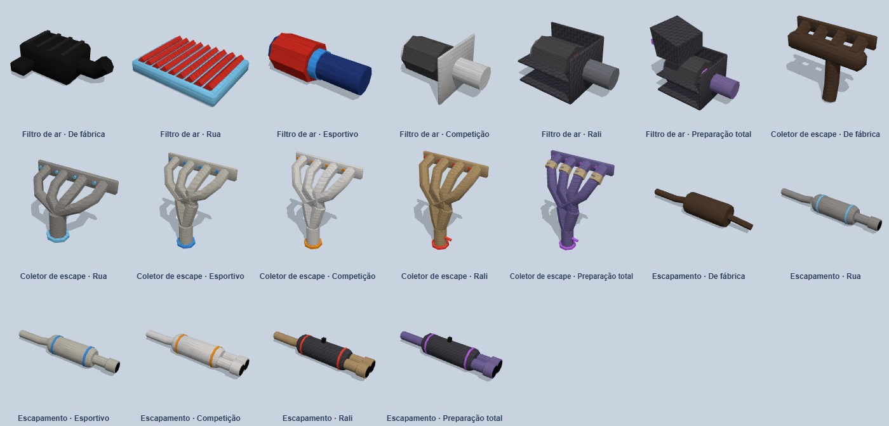

### Filtro de ar

| Prévia | Nível | Peça | Triângulos | Medidas | Tamanho |
|---|---|---|---|---|---|
| 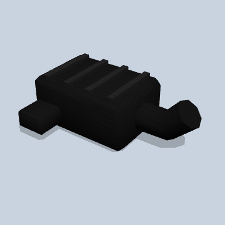 | De fábrica<br>`fabrica` | **Filtro de ar de fábrica**<br>[`filtro_ar_fabrica.glb`](modelos/filtro_ar/filtro_ar_fabrica.glb) | 180 | 52 cm × 17 cm × 33 cm | 14,8 KB |
| 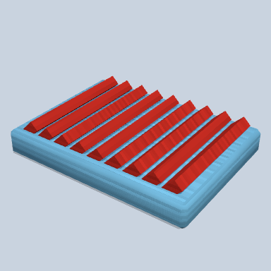 | Rua<br>`n1` | **Filtro esportivo de painel**<br>[`filtro_ar_n1.glb`](modelos/filtro_ar/filtro_ar_n1.glb) | 152 | 30 cm × 6 cm × 22 cm | 15,3 KB |
| 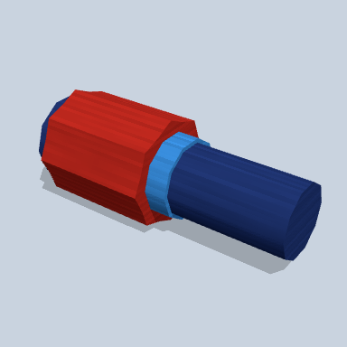 | Esportivo<br>`n2` | **Filtro de alto fluxo lavável**<br>[`filtro_ar_n2.glb`](modelos/filtro_ar/filtro_ar_n2.glb) | 180 | 37 cm × 15 cm × 15 cm | 14,1 KB |
| 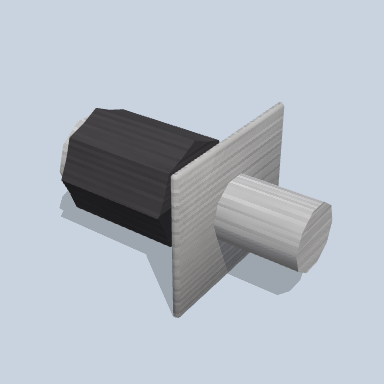 | Competição<br>`n3` | **Filtro cônico com tomada de ar frio**<br>[`filtro_ar_n3.glb`](modelos/filtro_ar/filtro_ar_n3.glb) | 224 | 39 cm × 22 cm × 26 cm | 17,4 KB |
| 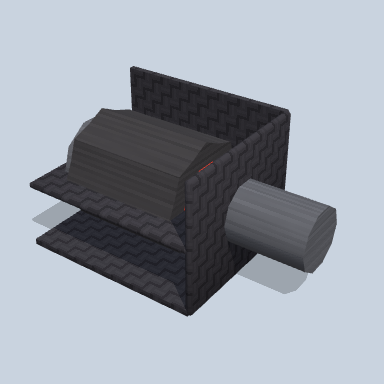 | Rali<br>`n4` | **Caixa de ar fechada**<br>[`filtro_ar_n4.glb`](modelos/filtro_ar/filtro_ar_n4.glb) | 292 | 43 cm × 22 cm × 26 cm | 23,2 KB |
| 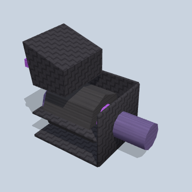 | Preparação total<br>`n5` | **Admissão de competição com tomada dinâmica**<br>[`filtro_ar_n5.glb`](modelos/filtro_ar/filtro_ar_n5.glb) | 316 | 46 cm × 38 cm × 26 cm | 25,3 KB |

### Coletor de escape

| Prévia | Nível | Peça | Triângulos | Medidas | Tamanho |
|---|---|---|---|---|---|
| 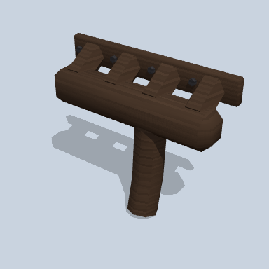 | De fábrica<br>`fabrica` | **Coletor de escape de fábrica**<br>[`coletor_escape_fabrica.glb`](modelos/coletor_escape/coletor_escape_fabrica.glb) | 308 | 42 cm × 34 cm × 15 cm | 23,3 KB |
| 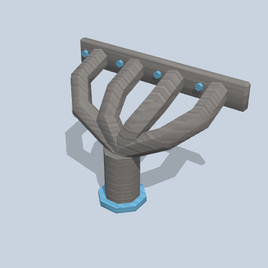 | Rua<br>`n1` | **Coletor dimensionado 4x1**<br>[`coletor_escape_n1.glb`](modelos/coletor_escape/coletor_escape_n1.glb) | 412 | 42 cm × 29 cm × 19 cm | 29,9 KB |
| 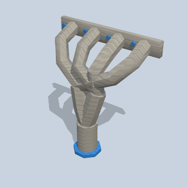 | Esportivo<br>`n2` | **Coletor 4x2x1**<br>[`coletor_escape_n2.glb`](modelos/coletor_escape/coletor_escape_n2.glb) | 488 | 42 cm × 46 cm × 19 cm | 34,4 KB |
| 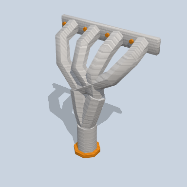 | Competição<br>`n3` | **Coletor 4x2x1 em inox**<br>[`coletor_escape_n3.glb`](modelos/coletor_escape/coletor_escape_n3.glb) | 488 | 42 cm × 49 cm × 19 cm | 34,6 KB |
| 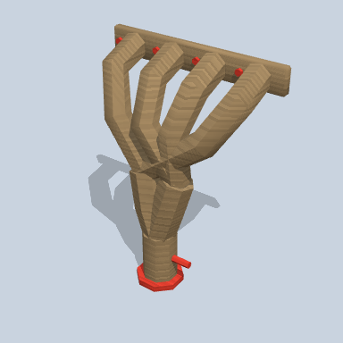 | Rali<br>`n4` | **Coletor de competição em inox**<br>[`coletor_escape_n4.glb`](modelos/coletor_escape/coletor_escape_n4.glb) | 512 | 42 cm × 52 cm × 19 cm | 36,1 KB |
| 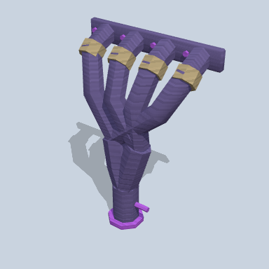 | Preparação total<br>`n5` | **Coletor de competição de tubos longos**<br>[`coletor_escape_n5.glb`](modelos/coletor_escape/coletor_escape_n5.glb) | 608 | 42 cm × 55 cm × 19 cm | 44,1 KB |

### Escapamento

| Prévia | Nível | Peça | Triângulos | Medidas | Tamanho |
|---|---|---|---|---|---|
| 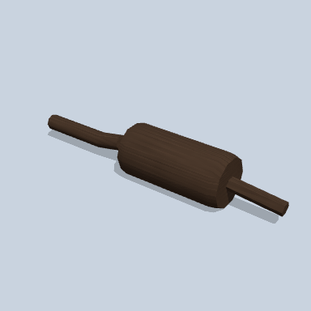 | De fábrica<br>`fabrica` | **Escapamento de fábrica**<br>[`escape_fabrica.glb`](modelos/escape/escape_fabrica.glb) | 144 | 1,00 m × 19 cm × 20 cm | 11,4 KB |
| 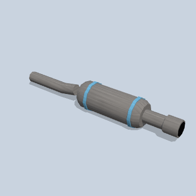 | Rua<br>`n1` | **Escapamento esportivo (abafador direto)**<br>[`escape_n1.glb`](modelos/escape/escape_n1.glb) | 284 | 1,00 m × 16 cm × 17 cm | 19,0 KB |
| 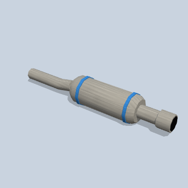 | Esportivo<br>`n2` | **Escapamento dimensionado**<br>[`escape_n2.glb`](modelos/escape/escape_n2.glb) | 284 | 1,02 m × 18 cm × 18 cm | 19,0 KB |
| 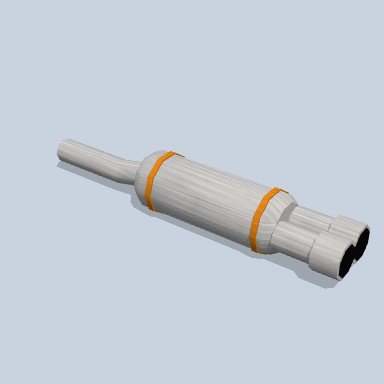 | Competição<br>`n3` | **Escapamento dimensionado em inox**<br>[`escape_n3.glb`](modelos/escape/escape_n3.glb) | 364 | 1,04 m × 19 cm × 20 cm | 24,7 KB |
| 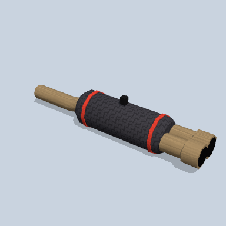 | Rali<br>`n4` | **Escapamento de competição**<br>[`escape_n4.glb`](modelos/escape/escape_n4.glb) | 376 | 1,06 m × 24 cm × 21 cm | 31,2 KB |
| 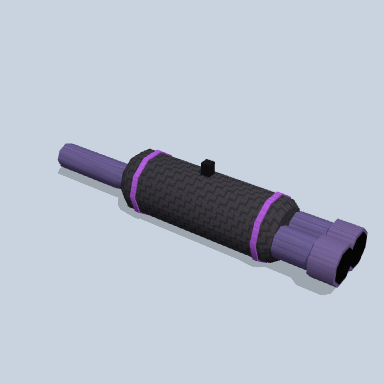 | Preparação total<br>`n5` | **Escapamento de competição em titânio**<br>[`escape_n5.glb`](modelos/escape/escape_n5.glb) | 376 | 1,08 m × 25 cm × 22 cm | 31,2 KB |

## Motor: preparação interna

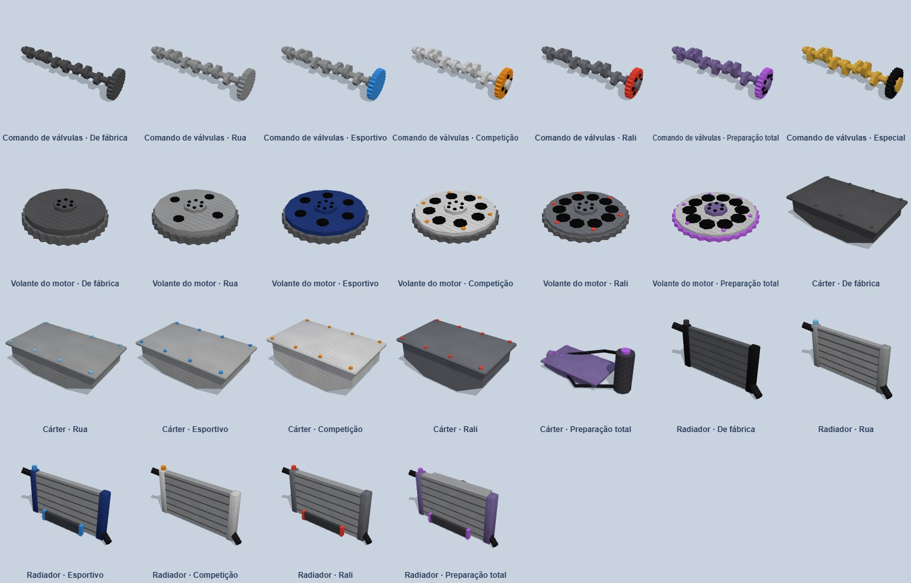

### Comando de válvulas

| Prévia | Nível | Peça | Triângulos | Medidas | Tamanho |
|---|---|---|---|---|---|
| 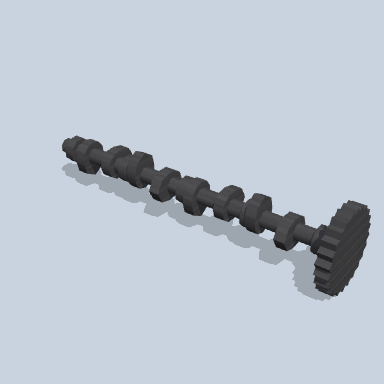 | De fábrica<br>`fabrica` | **Comando de válvulas de fábrica**<br>[`comando_fabrica.glb`](modelos/comando/comando_fabrica.glb) | 704 | 48 cm × 12 cm × 12 cm | 45,7 KB |
|  | Rua<br>`n1` | **Comando de rua (graduação suave)**<br>[`comando_n1.glb`](modelos/comando/comando_n1.glb) | 704 | 48 cm × 12 cm × 12 cm | 45,6 KB |
| 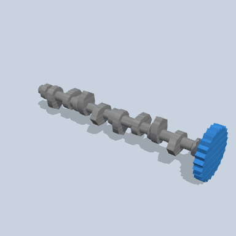 | Esportivo<br>`n2` | **Comando esportivo**<br>[`comando_n2.glb`](modelos/comando/comando_n2.glb) | 704 | 48 cm × 12 cm × 12 cm | 45,6 KB |
| 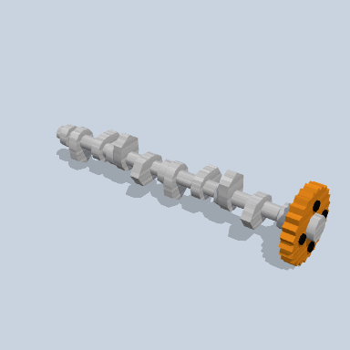 | Competição<br>`n3` | **Comando bravo**<br>[`comando_n3.glb`](modelos/comando/comando_n3.glb) | 832 | 49 cm × 12 cm × 12 cm | 55,1 KB |
| 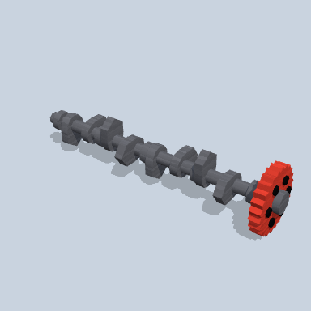 | Rali<br>`n4` | **Comando de competição**<br>[`comando_n4.glb`](modelos/comando/comando_n4.glb) | 880 | 49 cm × 12 cm × 12 cm | 58,3 KB |
| 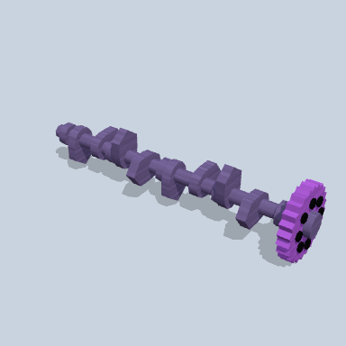 | Preparação total<br>`n5` | **Comando de alta graduação**<br>[`comando_n5.glb`](modelos/comando/comando_n5.glb) | 928 | 49 cm × 12 cm × 12 cm | 61,6 KB |
| 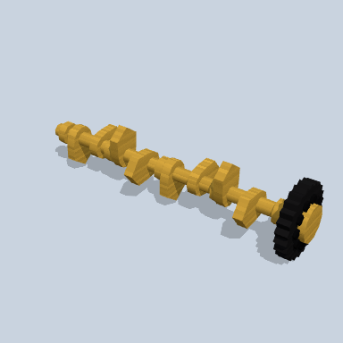 | Especial<br>`especial` | **Comando da série especial (prêmio)**<br>[`comando_especial.glb`](modelos/comando/comando_especial.glb) | 1.016 | 49 cm × 12 cm × 12 cm | 67,0 KB |

### Volante do motor

| Prévia | Nível | Peça | Triângulos | Medidas | Tamanho |
|---|---|---|---|---|---|
| 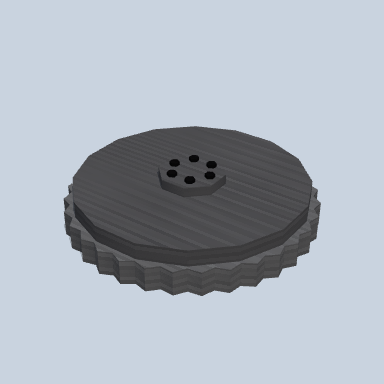 | De fábrica<br>`fabrica` | **Volante do motor de fábrica**<br>[`volante_motor_fabrica.glb`](modelos/volante_motor/volante_motor_fabrica.glb) | 496 | 30 cm × 7 cm × 30 cm | 34,5 KB |
| 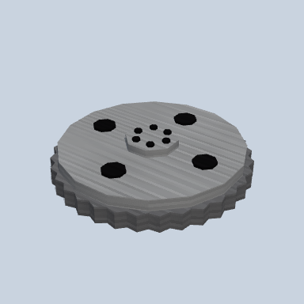 | Rua<br>`n1` | **Volante aliviado**<br>[`volante_motor_n1.glb`](modelos/volante_motor/volante_motor_n1.glb) | 624 | 30 cm × 6 cm × 30 cm | 41,8 KB |
| 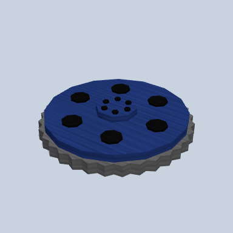 | Esportivo<br>`n2` | **Volante de aço leve**<br>[`volante_motor_n2.glb`](modelos/volante_motor/volante_motor_n2.glb) | 688 | 30 cm × 5 cm × 30 cm | 45,4 KB |
| 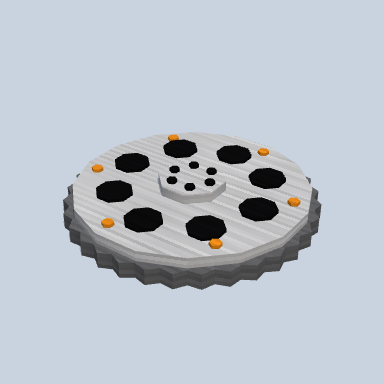 | Competição<br>`n3` | **Volante de aço leve balanceado**<br>[`volante_motor_n3.glb`](modelos/volante_motor/volante_motor_n3.glb) | 896 | 30 cm × 5 cm × 30 cm | 59,9 KB |
| 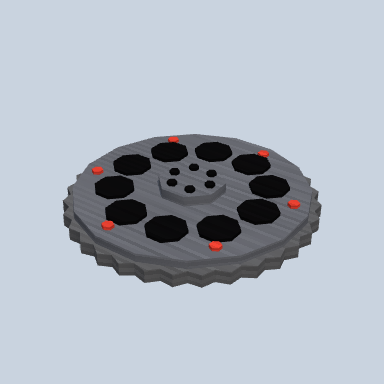 | Rali<br>`n4` | **Volante de cromo-molibdênio**<br>[`volante_motor_n4.glb`](modelos/volante_motor/volante_motor_n4.glb) | 960 | 30 cm × 4 cm × 30 cm | 63,6 KB |
| 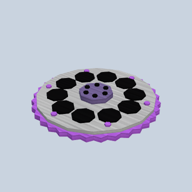 | Preparação total<br>`n5` | **Volante de competição em alumínio**<br>[`volante_motor_n5.glb`](modelos/volante_motor/volante_motor_n5.glb) | 960 | 30 cm × 4 cm × 30 cm | 63,6 KB |

### Cárter

| Prévia | Nível | Peça | Triângulos | Medidas | Tamanho |
|---|---|---|---|---|---|
| 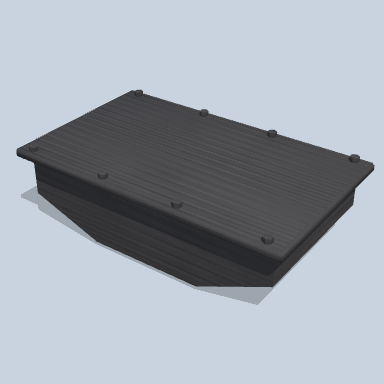 | De fábrica<br>`fabrica` | **Cárter de fábrica**<br>[`carter_fabrica.glb`](modelos/carter/carter_fabrica.glb) | 280 | 50 cm × 15 cm × 30 cm | 22,1 KB |
| 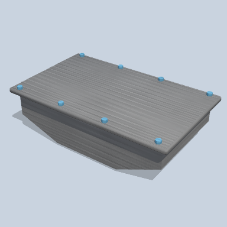 | Rua<br>`n1` | **Cárter com chicanas**<br>[`carter_n1.glb`](modelos/carter/carter_n1.glb) | 280 | 50 cm × 15 cm × 30 cm | 22,1 KB |
| 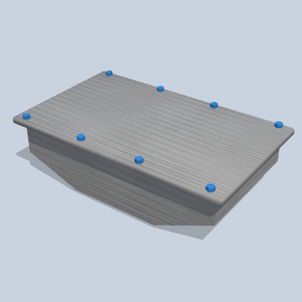 | Esportivo<br>`n2` | **Cárter aletado com chicanas**<br>[`carter_n2.glb`](modelos/carter/carter_n2.glb) | 340 | 50 cm × 15 cm × 30 cm | 27,2 KB |
| 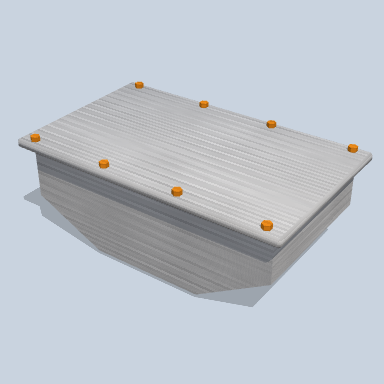 | Competição<br>`n3` | **Cárter ampliado com portinholas**<br>[`carter_n3.glb`](modelos/carter/carter_n3.glb) | 352 | 50 cm × 19 cm × 30 cm | 28,3 KB |
| 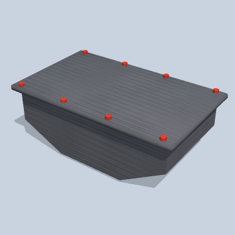 | Rali<br>`n4` | **Cárter de competição com portinholas**<br>[`carter_n4.glb`](modelos/carter/carter_n4.glb) | 364 | 50 cm × 19 cm × 30 cm | 29,3 KB |
| 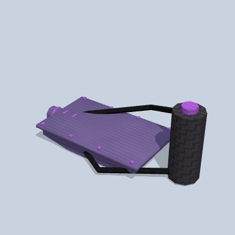 | Preparação total<br>`n5` | **Cárter seco**<br>[`carter_n5.glb`](modelos/carter/carter_n5.glb) | 628 | 72 cm × 31 cm × 38 cm | 50,9 KB |

### Radiador

| Prévia | Nível | Peça | Triângulos | Medidas | Tamanho |
|---|---|---|---|---|---|
| 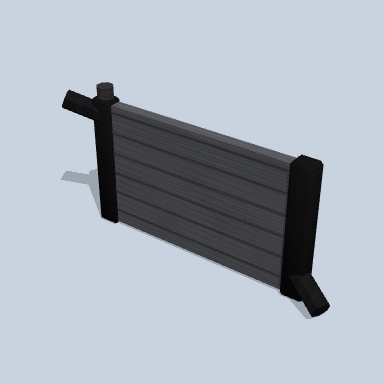 | De fábrica<br>`fabrica` | **Radiador de fábrica**<br>[`radiador_fabrica.glb`](modelos/radiador/radiador_fabrica.glb) | 252 | 77 cm × 39 cm × 10 cm | 24,5 KB |
| 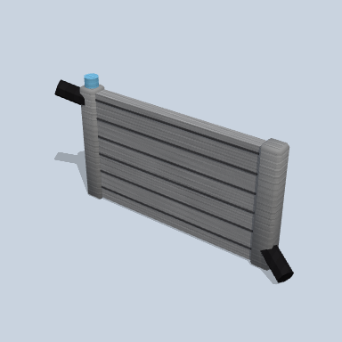 | Rua<br>`n1` | **Radiador de alumínio**<br>[`radiador_n1.glb`](modelos/radiador/radiador_n1.glb) | 252 | 81 cm × 41 cm × 10 cm | 24,5 KB |
| 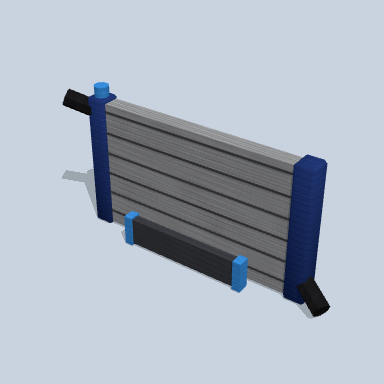 | Esportivo<br>`n2` | **Radiador de alumínio com radiador de óleo**<br>[`radiador_n2.glb`](modelos/radiador/radiador_n2.glb) | 288 | 85 cm × 43 cm × 11 cm | 27,5 KB |
| 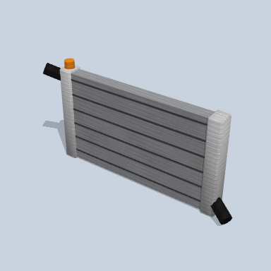 | Competição<br>`n3` | **Radiador de alta capacidade**<br>[`radiador_n3.glb`](modelos/radiador/radiador_n3.glb) | 252 | 89 cm × 45 cm × 11 cm | 25,6 KB |
| 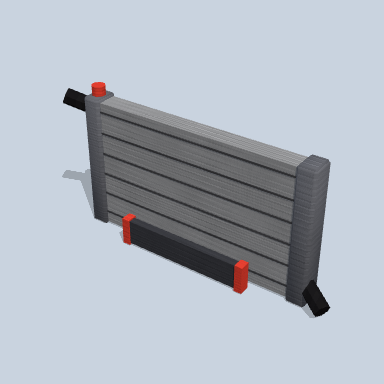 | Rali<br>`n4` | **Radiador de alta capacidade com radiador de óleo**<br>[`radiador_n4.glb`](modelos/radiador/radiador_n4.glb) | 288 | 93 cm × 47 cm × 13 cm | 28,6 KB |
| 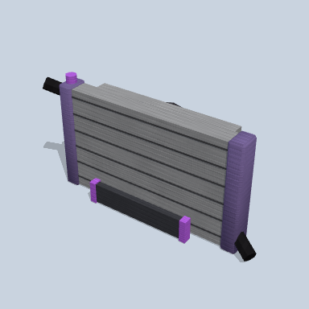 | Preparação total<br>`n5` | **Arrefecimento de competição (radiador duplo e eletroventilador)**<br>[`radiador_n5.glb`](modelos/radiador/radiador_n5.glb) | 416 | 93 cm × 47 cm × 24 cm | 39,3 KB |

## Motor: injeção eletrônica

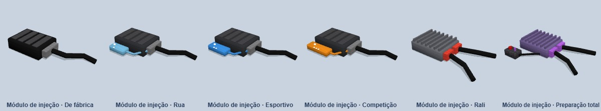

### Módulo de injeção

| Prévia | Nível | Peça | Triângulos | Medidas | Tamanho |
|---|---|---|---|---|---|
| 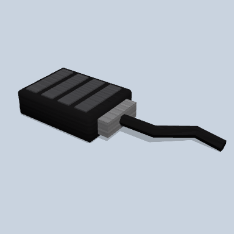 | De fábrica<br>`fabrica` | **Módulo de injeção de fábrica**<br>[`ecu_fabrica.glb`](modelos/ecu/ecu_fabrica.glb) | 148 | 42 cm × 6 cm × 15 cm | 14,2 KB |
| 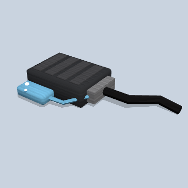 | Rua<br>`n1` | **Remapeamento (estágio 1)**<br>[`ecu_n1.glb`](modelos/ecu/ecu_n1.glb) | 262 | 42 cm × 6 cm × 21 cm | 24,1 KB |
| 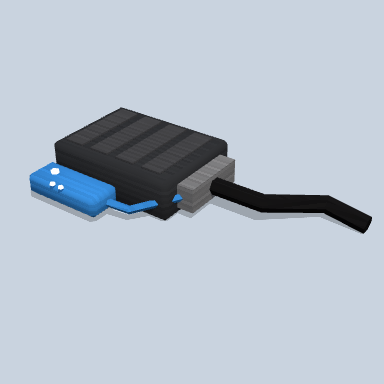 | Esportivo<br>`n2` | **Remapeamento (estágio 2)**<br>[`ecu_n2.glb`](modelos/ecu/ecu_n2.glb) | 282 | 42 cm × 6 cm × 21 cm | 25,4 KB |
| 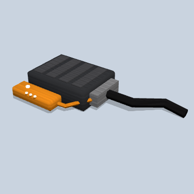 | Competição<br>`n3` | **Remapeamento (estágio 3)**<br>[`ecu_n3.glb`](modelos/ecu/ecu_n3.glb) | 302 | 42 cm × 6 cm × 21 cm | 27,9 KB |
| 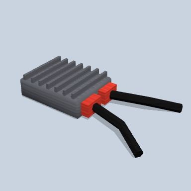 | Rali<br>`n4` | **Injeção programável**<br>[`ecu_n4.glb`](modelos/ecu/ecu_n4.glb) | 216 | 44 cm × 8 cm × 26 cm | 20,5 KB |
|  | Preparação total<br>`n5` | **Injeção programável com controle de largada**<br>[`ecu_n5.glb`](modelos/ecu/ecu_n5.glb) | 342 | 45 cm × 8 cm × 33 cm | 29,5 KB |

## Turbo e compressor


### Turbina

| Prévia | Nível | Peça | Triângulos | Medidas | Tamanho |
|---|---|---|---|---|---|
|  | De fábrica<br>`fabrica` | **Turbina de fábrica**<br>[`turbo_fabrica.glb`](modelos/turbo/turbo_fabrica.glb) | 668 | 30 cm × 21 cm × 25 cm | 42,9 KB |
|  | Rua<br>`n1` | **Turbina recalibrada (mais pressão)**<br>[`turbo_n1.glb`](modelos/turbo/turbo_n1.glb) | 668 | 33 cm × 23 cm × 27 cm | 42,9 KB |
|  | Esportivo<br>`n2` | **Turbina maior de rolamento**<br>[`turbo_n2.glb`](modelos/turbo/turbo_n2.glb) | 668 | 35 cm × 24 cm × 29 cm | 42,9 KB |
|  | Competição<br>`n3` | **Turbina de alta vazão**<br>[`turbo_n3.glb`](modelos/turbo/turbo_n3.glb) | 684 | 38 cm × 29 cm × 31 cm | 44,1 KB |
|  | Rali<br>`n4` | **Turbina de alta vazão com válvula de alívio externa**<br>[`turbo_n4.glb`](modelos/turbo/turbo_n4.glb) | 732 | 40 cm × 31 cm × 35 cm | 46,8 KB |
|  | Preparação total<br>`n5` | **Turbina de dupla entrada**<br>[`turbo_n5.glb`](modelos/turbo/turbo_n5.glb) | 744 | 43 cm × 33 cm × 37 cm | 47,8 KB |

### Intercooler

| Prévia | Nível | Peça | Triângulos | Medidas | Tamanho |
|---|---|---|---|---|---|
|  | De fábrica<br>`fabrica` | **Intercooler de fábrica**<br>[`intercooler_fabrica.glb`](modelos/intercooler/intercooler_fabrica.glb) | 272 | 64 cm × 20 cm × 20 cm | 26,6 KB |
|  | Rua<br>`n1` | **Intercooler maior**<br>[`intercooler_n1.glb`](modelos/intercooler/intercooler_n1.glb) | 272 | 70 cm × 22 cm × 20 cm | 26,6 KB |
|  | Esportivo<br>`n2` | **Intercooler frontal**<br>[`intercooler_n2.glb`](modelos/intercooler/intercooler_n2.glb) | 272 | 90 cm × 24 cm × 20 cm | 26,6 KB |
|  | Competição<br>`n3` | **Intercooler frontal de colmeia grossa**<br>[`intercooler_n3.glb`](modelos/intercooler/intercooler_n3.glb) | 272 | 94 cm × 26 cm × 22 cm | 27,7 KB |
|  | Rali<br>`n4` | **Intercooler frontal de competição**<br>[`intercooler_n4.glb`](modelos/intercooler/intercooler_n4.glb) | 272 | 98 cm × 27 cm × 22 cm | 27,7 KB |
|  | Preparação total<br>`n5` | **Intercooler frontal com borrifador de água**<br>[`intercooler_n5.glb`](modelos/intercooler/intercooler_n5.glb) | 456 | 100 cm × 29 cm × 32 cm | 39,5 KB |

### Compressor mecânico

| Prévia | Nível | Peça | Triângulos | Medidas | Tamanho |
|---|---|---|---|---|---|
|  | De fábrica<br>`fabrica` | **Compressor mecânico de fábrica**<br>[`compressor_fabrica.glb`](modelos/compressor/compressor_fabrica.glb) | 164 | 41 cm × 12 cm × 22 cm | 14,5 KB |
|  | Rua<br>`n1` | **Compressor de lóbulos de baixa pressão**<br>[`compressor_n1.glb`](modelos/compressor/compressor_n1.glb) | 248 | 38 cm × 21 cm × 18 cm | 19,9 KB |
|  | Esportivo<br>`n2` | **Compressor de lóbulos**<br>[`compressor_n2.glb`](modelos/compressor/compressor_n2.glb) | 260 | 42 cm × 21 cm × 18 cm | 20,9 KB |
|  | Competição<br>`n3` | **Compressor de lóbulos com intercooler**<br>[`compressor_n3.glb`](modelos/compressor/compressor_n3.glb) | 312 | 46 cm × 28 cm × 22 cm | 30,0 KB |
|  | Rali<br>`n4` | **Compressor de parafuso**<br>[`compressor_n4.glb`](modelos/compressor/compressor_n4.glb) | 468 | 50 cm × 22 cm × 20 cm | 29,6 KB |
|  | Preparação total<br>`n5` | **Compressor de parafuso com intercooler**<br>[`compressor_n5.glb`](modelos/compressor/compressor_n5.glb) | 508 | 50 cm × 29 cm × 23 cm | 36,6 KB |

## Transmissão


### Embreagem

| Prévia | Nível | Peça | Triângulos | Medidas | Tamanho |
|---|---|---|---|---|---|
|  | De fábrica<br>`fabrica` | **Embreagem de fábrica**<br>[`embreagem_fabrica.glb`](modelos/embreagem/embreagem_fabrica.glb) | 584 | 25 cm × 8 cm × 25 cm | 43,0 KB |
|  | Rua<br>`n1` | **Embreagem reforçada (disco orgânico)**<br>[`embreagem_n1.glb`](modelos/embreagem/embreagem_n1.glb) | 632 | 25 cm × 8 cm × 25 cm | 46,2 KB |
|  | Esportivo<br>`n2` | **Embreagem de platô reforçado**<br>[`embreagem_n2.glb`](modelos/embreagem/embreagem_n2.glb) | 632 | 25 cm × 8 cm × 25 cm | 46,2 KB |
|  | Competição<br>`n3` | **Embreagem cerametálica**<br>[`embreagem_n3.glb`](modelos/embreagem/embreagem_n3.glb) | 688 | 25 cm × 8 cm × 25 cm | 52,5 KB |
|  | Rali<br>`n4` | **Embreagem bidisco cerametálica**<br>[`embreagem_n4.glb`](modelos/embreagem/embreagem_n4.glb) | 952 | 25 cm × 9 cm × 25 cm | 70,7 KB |
|  | Preparação total<br>`n5` | **Embreagem multidisco de competição**<br>[`embreagem_n5.glb`](modelos/embreagem/embreagem_n5.glb) | 1.480 | 20 cm × 12 cm × 20 cm | 107,1 KB |

### Câmbio

| Prévia | Nível | Peça | Triângulos | Medidas | Tamanho |
|---|---|---|---|---|---|
|  | De fábrica<br>`fabrica` | **Câmbio de fábrica**<br>[`cambio_fabrica.glb`](modelos/cambio/cambio_fabrica.glb) | 276 | 57 cm × 58 cm × 35 cm | 24,1 KB |
|  | Rua<br>`n1` | **Câmbio com relações mais curtas**<br>[`cambio_n1.glb`](modelos/cambio/cambio_n1.glb) | 288 | 57 cm × 55 cm × 35 cm | 25,1 KB |
|  | Esportivo<br>`n2` | **Câmbio de relações fechadas**<br>[`cambio_n2.glb`](modelos/cambio/cambio_n2.glb) | 288 | 57 cm × 52 cm × 35 cm | 25,1 KB |
|  | Competição<br>`n3` | **Câmbio de engates retos**<br>[`cambio_n3.glb`](modelos/cambio/cambio_n3.glb) | 432 | 57 cm × 49 cm × 35 cm | 35,6 KB |
|  | Rali<br>`n4` | **Câmbio sequencial de engates retos**<br>[`cambio_n4.glb`](modelos/cambio/cambio_n4.glb) | 494 | 57 cm × 62 cm × 35 cm | 36,7 KB |
|  | Preparação total<br>`n5` | **Câmbio sequencial com borboletas**<br>[`cambio_n5.glb`](modelos/cambio/cambio_n5.glb) | 542 | 61 cm × 62 cm × 38 cm | 43,5 KB |
|  | Especial<br>`especial` | **Câmbio de engate rápido reforçado (prêmio)**<br>[`cambio_especial.glb`](modelos/cambio/cambio_especial.glb) | 542 | 61 cm × 62 cm × 38 cm | 43,5 KB |

### Diferencial

| Prévia | Nível | Peça | Triângulos | Medidas | Tamanho |
|---|---|---|---|---|---|
|  | De fábrica<br>`fabrica` | **Diferencial de fábrica**<br>[`diferencial_fabrica.glb`](modelos/diferencial/diferencial_fabrica.glb) | 584 | 59 cm × 24 cm × 29 cm | 37,4 KB |
|  | Rua<br>`n1` | **Autoblocante viscoso**<br>[`diferencial_n1.glb`](modelos/diferencial/diferencial_n1.glb) | 584 | 59 cm × 24 cm × 29 cm | 37,4 KB |
|  | Esportivo<br>`n2` | **Autoblocante mecânico de 1 via**<br>[`diferencial_n2.glb`](modelos/diferencial/diferencial_n2.glb) | 620 | 59 cm × 24 cm × 30 cm | 40,4 KB |
|  | Competição<br>`n3` | **Autoblocante mecânico de 1,5 via**<br>[`diferencial_n3.glb`](modelos/diferencial/diferencial_n3.glb) | 632 | 59 cm × 24 cm × 30 cm | 41,4 KB |
|  | Rali<br>`n4` | **Autoblocante de 2 vias**<br>[`diferencial_n4.glb`](modelos/diferencial/diferencial_n4.glb) | 644 | 59 cm × 24 cm × 30 cm | 44,2 KB |
|  | Preparação total<br>`n5` | **Autoblocante de 2 vias com rampas reguláveis**<br>[`diferencial_n5.glb`](modelos/diferencial/diferencial_n5.glb) | 688 | 59 cm × 25 cm × 33 cm | 47,0 KB |

### Semieixos e homocinéticas

| Prévia | Nível | Peça | Triângulos | Medidas | Tamanho |
|---|---|---|---|---|---|
|  | De fábrica<br>`fabrica` | **Semieixos e homocinéticas de fábrica**<br>[`semieixos_fabrica.glb`](modelos/semieixos/semieixos_fabrica.glb) | 616 | 94 cm × 12 cm × 12 cm | 45,1 KB |
|  | Rua<br>`n1` | **Homocinéticas reforçadas**<br>[`semieixos_n1.glb`](modelos/semieixos/semieixos_n1.glb) | 616 | 94 cm × 12 cm × 12 cm | 45,1 KB |
|  | Esportivo<br>`n2` | **Semieixos reforçados**<br>[`semieixos_n2.glb`](modelos/semieixos/semieixos_n2.glb) | 616 | 94 cm × 12 cm × 12 cm | 45,1 KB |
|  | Competição<br>`n3` | **Semieixos tratados com homocinéticas reforçadas**<br>[`semieixos_n3.glb`](modelos/semieixos/semieixos_n3.glb) | 680 | 94 cm × 12 cm × 12 cm | 49,9 KB |
|  | Rali<br>`n4` | **Semieixos de cromo-molibdênio**<br>[`semieixos_n4.glb`](modelos/semieixos/semieixos_n4.glb) | 680 | 94 cm × 12 cm × 12 cm | 49,9 KB |
|  | Preparação total<br>`n5` | **Semieixos de competição com homocinéticas de rali**<br>[`semieixos_n5.glb`](modelos/semieixos/semieixos_n5.glb) | 680 | 94 cm × 12 cm × 12 cm | 49,9 KB |

## Suspensão e chassi


### Molas

| Prévia | Nível | Peça | Triângulos | Medidas | Tamanho |
|---|---|---|---|---|---|
|  | De fábrica<br>`fabrica` | **Molas de fábrica**<br>[`molas_fabrica.glb`](modelos/molas/molas_fabrica.glb) | 566 | 15 cm × 26 cm × 15 cm | 36,6 KB |
|  | Rua<br>`n1` | **Molas esportivas**<br>[`molas_n1.glb`](modelos/molas/molas_n1.glb) | 566 | 15 cm × 24 cm × 15 cm | 36,6 KB |
|  | Esportivo<br>`n2` | **Molas de competição**<br>[`molas_n2.glb`](modelos/molas/molas_n2.glb) | 606 | 15 cm × 24 cm × 15 cm | 38,7 KB |
|  | Competição<br>`n3` | **Molas de rali**<br>[`molas_n3.glb`](modelos/molas/molas_n3.glb) | 646 | 15 cm × 26 cm × 15 cm | 41,0 KB |
|  | Rali<br>`n4` | **Molas de rali de curso longo**<br>[`molas_n4.glb`](modelos/molas/molas_n4.glb) | 932 | 15 cm × 36 cm × 15 cm | 57,4 KB |
|  | Preparação total<br>`n5` | **Molas progressivas de rali**<br>[`molas_n5.glb`](modelos/molas/molas_n5.glb) | 1.012 | 15 cm × 38 cm × 15 cm | 61,9 KB |

### Amortecedores

| Prévia | Nível | Peça | Triângulos | Medidas | Tamanho |
|---|---|---|---|---|---|
|  | De fábrica<br>`fabrica` | **Amortecedores de fábrica**<br>[`amortecedores_fabrica.glb`](modelos/amortecedores/amortecedores_fabrica.glb) | 180 | 5 cm × 53 cm × 5 cm | 19,8 KB |
|  | Rua<br>`n1` | **Amortecedores pressurizados**<br>[`amortecedores_n1.glb`](modelos/amortecedores/amortecedores_n1.glb) | 220 | 6 cm × 53 cm × 6 cm | 21,9 KB |
|  | Esportivo<br>`n2` | **Amortecedores com regulagem de 1 via**<br>[`amortecedores_n2.glb`](modelos/amortecedores/amortecedores_n2.glb) | 252 | 7 cm × 53 cm × 8 cm | 23,8 KB |
|  | Competição<br>`n3` | **Amortecedores de 2 vias**<br>[`amortecedores_n3.glb`](modelos/amortecedores/amortecedores_n3.glb) | 284 | 7 cm × 53 cm × 9 cm | 24,5 KB |
|  | Rali<br>`n4` | **Amortecedores de 2 vias com reservatório**<br>[`amortecedores_n4.glb`](modelos/amortecedores/amortecedores_n4.glb) | 336 | 12 cm × 53 cm × 9 cm | 27,7 KB |
|  | Preparação total<br>`n5` | **Amortecedores de 3 vias de rali**<br>[`amortecedores_n5.glb`](modelos/amortecedores/amortecedores_n5.glb) | 432 | 22 cm × 53 cm × 13 cm | 34,4 KB |
|  | Especial<br>`especial` | **Amortecedores com válvulas sob medida (prêmio)**<br>[`amortecedores_especial.glb`](modelos/amortecedores/amortecedores_especial.glb) | 432 | 22 cm × 53 cm × 13 cm | 34,4 KB |

### Barras estabilizadoras

| Prévia | Nível | Peça | Triângulos | Medidas | Tamanho |
|---|---|---|---|---|---|
|  | De fábrica<br>`fabrica` | **Barras estabilizadoras de fábrica**<br>[`barras_fabrica.glb`](modelos/barras/barras_fabrica.glb) | 284 | 65 cm × 20 cm × 26 cm | 24,2 KB |
|  | Rua<br>`n1` | **Barras mais grossas**<br>[`barras_n1.glb`](modelos/barras/barras_n1.glb) | 284 | 65 cm × 20 cm × 26 cm | 24,1 KB |
|  | Esportivo<br>`n2` | **Barras reguláveis**<br>[`barras_n2.glb`](modelos/barras/barras_n2.glb) | 452 | 65 cm × 20 cm × 27 cm | 35,9 KB |
|  | Competição<br>`n3` | **Barras reguláveis tubulares**<br>[`barras_n3.glb`](modelos/barras/barras_n3.glb) | 452 | 65 cm × 20 cm × 27 cm | 37,0 KB |
|  | Rali<br>`n4` | **Barras tubulares com buchas de competição**<br>[`barras_n4.glb`](modelos/barras/barras_n4.glb) | 452 | 65 cm × 20 cm × 27 cm | 33,3 KB |
|  | Preparação total<br>`n5` | **Barras de regulagem rápida**<br>[`barras_n5.glb`](modelos/barras/barras_n5.glb) | 516 | 68 cm × 20 cm × 27 cm | 37,0 KB |

### Protetor de cárter

| Prévia | Nível | Peça | Triângulos | Medidas | Tamanho |
|---|---|---|---|---|---|
|  | De fábrica<br>`fabrica` | **Protetor de cárter de fábrica**<br>[`protetor_fabrica.glb`](modelos/protetor/protetor_fabrica.glb) | 180 | 70 cm × 16 cm × 83 cm | 17,7 KB |
|  | Rua<br>`n1` | **Protetor de aço**<br>[`protetor_n1.glb`](modelos/protetor/protetor_n1.glb) | 244 | 70 cm × 16 cm × 83 cm | 21,3 KB |
|  | Esportivo<br>`n2` | **Protetor de aço grosso**<br>[`protetor_n2.glb`](modelos/protetor/protetor_n2.glb) | 244 | 70 cm × 16 cm × 83 cm | 21,3 KB |
|  | Competição<br>`n3` | **Protetor de alumínio**<br>[`protetor_n3.glb`](modelos/protetor/protetor_n3.glb) | 308 | 70 cm × 16 cm × 83 cm | 26,1 KB |
|  | Rali<br>`n4` | **Protetor de alumínio grosso**<br>[`protetor_n4.glb`](modelos/protetor/protetor_n4.glb) | 332 | 70 cm × 16 cm × 83 cm | 28,1 KB |
|  | Preparação total<br>`n5` | **Protetor de compósito**<br>[`protetor_n5.glb`](modelos/protetor/protetor_n5.glb) | 396 | 70 cm × 16 cm × 83 cm | 33,5 KB |

### Gaiola de segurança

| Prévia | Nível | Peça | Triângulos | Medidas | Tamanho |
|---|---|---|---|---|---|
|  | De fábrica<br>`fabrica` | **Gaiola de segurança de fábrica**<br>[`gaiola_fabrica.glb`](modelos/gaiola/gaiola_fabrica.glb) | 68 | 1,26 m × 1,08 m × 19 cm | 13,2 KB |
|  | Rua<br>`n1` | **Santo antônio parafusado**<br>[`gaiola_n1.glb`](modelos/gaiola/gaiola_n1.glb) | 564 | 1,30 m × 1,08 m × 1,00 m | 41,6 KB |
|  | Esportivo<br>`n2` | **Gaiola parafusada de 4 pontos**<br>[`gaiola_n2.glb`](modelos/gaiola/gaiola_n2.glb) | 584 | 1,30 m × 1,08 m × 1,00 m | 43,1 KB |
|  | Competição<br>`n3` | **Gaiola parafusada de 6 pontos**<br>[`gaiola_n3.glb`](modelos/gaiola/gaiola_n3.glb) | 908 | 1,30 m × 1,09 m × 2,30 m | 65,2 KB |
|  | Rali<br>`n4` | **Gaiola soldada multiponto**<br>[`gaiola_n4.glb`](modelos/gaiola/gaiola_n4.glb) | 452 | 1,30 m × 1,09 m × 2,30 m | 35,4 KB |
|  | Preparação total<br>`n5` | **Gaiola integrada de cromo-molibdênio**<br>[`gaiola_n5.glb`](modelos/gaiola/gaiola_n5.glb) | 596 | 1,30 m × 1,09 m × 2,30 m | 44,2 KB |

### Alívio de peso

| Prévia | Nível | Peça | Triângulos | Medidas | Tamanho |
|---|---|---|---|---|---|
|  | De fábrica<br>`fabrica` | **Alívio de peso de fábrica**<br>[`reducao_peso_fabrica.glb`](modelos/reducao_peso/reducao_peso_fabrica.glb) | 148 | 1,00 m × 97 cm × 73 cm | 15,0 KB |
|  | Rua<br>`n1` | **Sem acabamento interno**<br>[`reducao_peso_n1.glb`](modelos/reducao_peso/reducao_peso_n1.glb) | 136 | 1,00 m × 97 cm × 73 cm | 14,0 KB |
|  | Esportivo<br>`n2` | **Sem banco traseiro e forrações**<br>[`reducao_peso_n2.glb`](modelos/reducao_peso/reducao_peso_n2.glb) | 144 | 1,00 m × 97 cm × 73 cm | 14,7 KB |
|  | Competição<br>`n3` | **Painéis em fibra**<br>[`reducao_peso_n3.glb`](modelos/reducao_peso/reducao_peso_n3.glb) | 204 | 1,00 m × 97 cm × 73 cm | 20,6 KB |
|  | Rali<br>`n4` | **Vidros de policarbonato**<br>[`reducao_peso_n4.glb`](modelos/reducao_peso/reducao_peso_n4.glb) | 272 | 1,00 m × 97 cm × 73 cm | 25,4 KB |
|  | Preparação total<br>`n5` | **Carroceria aliviada completa**<br>[`reducao_peso_n5.glb`](modelos/reducao_peso/reducao_peso_n5.glb) | 412 | 1,00 m × 97 cm × 73 cm | 34,8 KB |
|  | Especial<br>`especial` | **Alívio com reforço nos pontos certos (prêmio)**<br>[`reducao_peso_especial.glb`](modelos/reducao_peso/reducao_peso_especial.glb) | 412 | 1,00 m × 97 cm × 73 cm | 34,8 KB |

## Freios


### Pastilhas de freio

| Prévia | Nível | Peça | Triângulos | Medidas | Tamanho |
|---|---|---|---|---|---|
|  | De fábrica<br>`fabrica` | **Pastilhas de freio de fábrica**<br>[`pastilhas_fabrica.glb`](modelos/pastilhas/pastilhas_fabrica.glb) | 128 | 19 cm × 6 cm × 9 cm | 14,2 KB |
|  | Rua<br>`n1` | **Pastilhas de alto atrito**<br>[`pastilhas_n1.glb`](modelos/pastilhas/pastilhas_n1.glb) | 128 | 19 cm × 6 cm × 9 cm | 14,2 KB |
|  | Esportivo<br>`n2` | **Pastilhas esportivas**<br>[`pastilhas_n2.glb`](modelos/pastilhas/pastilhas_n2.glb) | 128 | 19 cm × 6 cm × 10 cm | 14,2 KB |
|  | Competição<br>`n3` | **Pastilhas de competição**<br>[`pastilhas_n3.glb`](modelos/pastilhas/pastilhas_n3.glb) | 152 | 19 cm × 6 cm × 10 cm | 17,3 KB |
|  | Rali<br>`n4` | **Pastilhas de competição para terra**<br>[`pastilhas_n4.glb`](modelos/pastilhas/pastilhas_n4.glb) | 200 | 19 cm × 6 cm × 11 cm | 21,4 KB |
|  | Preparação total<br>`n5` | **Pastilhas de rali (mordem a frio)**<br>[`pastilhas_n5.glb`](modelos/pastilhas/pastilhas_n5.glb) | 172 | 24 cm × 13 cm × 11 cm | 18,9 KB |

### Discos e pinças

| Prévia | Nível | Peça | Triângulos | Medidas | Tamanho |
|---|---|---|---|---|---|
|  | De fábrica<br>`fabrica` | **Discos e pinças de fábrica**<br>[`discos_fabrica.glb`](modelos/discos/discos_fabrica.glb) | 336 | 9 cm × 28 cm × 26 cm | 23,7 KB |
|  | Rua<br>`n1` | **Discos ranhurados**<br>[`discos_n1.glb`](modelos/discos/discos_n1.glb) | 408 | 9 cm × 30 cm × 28 cm | 29,7 KB |
|  | Esportivo<br>`n2` | **Discos ventilados maiores**<br>[`discos_n2.glb`](modelos/discos/discos_n2.glb) | 568 | 11 cm × 32 cm × 30 cm | 37,7 KB |
|  | Competição<br>`n3` | **Discos ventilados com pinça de 4 pistões**<br>[`discos_n3.glb`](modelos/discos/discos_n3.glb) | 604 | 11 cm × 35 cm × 33 cm | 41,4 KB |
|  | Rali<br>`n4` | **Discos flutuantes com pinça de 4 pistões**<br>[`discos_n4.glb`](modelos/discos/discos_n4.glb) | 844 | 11 cm × 38 cm × 35 cm | 57,6 KB |
|  | Preparação total<br>`n5` | **Discos flutuantes com pinça de 6 pistões**<br>[`discos_n5.glb`](modelos/discos/discos_n5.glb) | 844 | 11 cm × 41 cm × 38 cm | 57,7 KB |

### Balanço de freio

| Prévia | Nível | Peça | Triângulos | Medidas | Tamanho |
|---|---|---|---|---|---|
|  | De fábrica<br>`fabrica` | **Balanço de freio de fábrica**<br>[`balanco_freio_fabrica.glb`](modelos/balanco_freio/balanco_freio_fabrica.glb) | 96 | 30 cm × 7 cm × 20 cm | 11,7 KB |
|  | Rua<br>`n1` | **Válvula reguladora no assoalho**<br>[`balanco_freio_n1.glb`](modelos/balanco_freio/balanco_freio_n1.glb) | 136 | 30 cm × 7 cm × 20 cm | 13,9 KB |
|  | Esportivo<br>`n2` | **Válvula reguladora no painel**<br>[`balanco_freio_n2.glb`](modelos/balanco_freio/balanco_freio_n2.glb) | 142 | 23 cm × 12 cm × 22 cm | 12,8 KB |
|  | Competição<br>`n3` | **Pedaleira com barra de balanço**<br>[`balanco_freio_n3.glb`](modelos/balanco_freio/balanco_freio_n3.glb) | 260 | 34 cm × 34 cm × 33 cm | 22,0 KB |
|  | Rali<br>`n4` | **Pedaleira de competição**<br>[`balanco_freio_n4.glb`](modelos/balanco_freio/balanco_freio_n4.glb) | 260 | 34 cm × 34 cm × 33 cm | 22,0 KB |
|  | Preparação total<br>`n5` | **Pedaleira de competição com regulagem no painel**<br>[`balanco_freio_n5.glb`](modelos/balanco_freio/balanco_freio_n5.glb) | 332 | 43 cm × 38 cm × 37 cm | 28,2 KB |

### Freio de mão

| Prévia | Nível | Peça | Triângulos | Medidas | Tamanho |
|---|---|---|---|---|---|
|  | De fábrica<br>`fabrica` | **Freio de mão de fábrica**<br>[`freio_mao_fabrica.glb`](modelos/freio_mao/freio_mao_fabrica.glb) | 184 | 13 cm × 17 cm × 78 cm | 19,0 KB |
|  | Rua<br>`n1` | **Freio de mão reforçado**<br>[`freio_mao_n1.glb`](modelos/freio_mao/freio_mao_n1.glb) | 184 | 13 cm × 17 cm × 78 cm | 19,0 KB |
|  | Esportivo<br>`n2` | **Freio de mão com cabo de competição**<br>[`freio_mao_n2.glb`](modelos/freio_mao/freio_mao_n2.glb) | 184 | 13 cm × 17 cm × 78 cm | 19,0 KB |
|  | Competição<br>`n3` | **Freio de mão hidráulico (alavanca vertical)**<br>[`freio_mao_n3.glb`](modelos/freio_mao/freio_mao_n3.glb) | 242 | 20 cm × 46 cm × 52 cm | 19,6 KB |
|  | Rali<br>`n4` | **Freio de mão hidráulico de competição**<br>[`freio_mao_n4.glb`](modelos/freio_mao/freio_mao_n4.glb) | 274 | 20 cm × 50 cm × 52 cm | 21,4 KB |
|  | Preparação total<br>`n5` | **Hidráulico com desacoplamento do diferencial central**<br>[`freio_mao_n5.glb`](modelos/freio_mao/freio_mao_n5.glb) | 326 | 20 cm × 56 cm × 53 cm | 24,8 KB |

## Carroceria e aerodinâmica


### Aerofólio traseiro

| Prévia | Nível | Peça | Triângulos | Medidas | Tamanho |
|---|---|---|---|---|---|
|  | De fábrica<br>`fabrica` | **Aerofólio traseiro de fábrica**<br>[`aerofolio_fabrica.glb`](modelos/aerofolio/aerofolio_fabrica.glb) | 24 | 1,00 m × 9 cm × 32 cm | 6,1 KB |
|  | Rua<br>`n1` | **Aerofólio de teto**<br>[`aerofolio_n1.glb`](modelos/aerofolio/aerofolio_n1.glb) | 48 | 1,05 m × 12 cm × 39 cm | 10,9 KB |
|  | Esportivo<br>`n2` | **Aerofólio de teto ampliado**<br>[`aerofolio_n2.glb`](modelos/aerofolio/aerofolio_n2.glb) | 72 | 1,15 m × 15 cm × 43 cm | 12,9 KB |
|  | Competição<br>`n3` | **Aerofólio regulável**<br>[`aerofolio_n3.glb`](modelos/aerofolio/aerofolio_n3.glb) | 208 | 1,21 m × 30 cm × 32 cm | 20,6 KB |
|  | Rali<br>`n4` | **Aerofólio de competição**<br>[`aerofolio_n4.glb`](modelos/aerofolio/aerofolio_n4.glb) | 100 | 1,31 m × 34 cm × 36 cm | 14,0 KB |
|  | Preparação total<br>`n5` | **Aerofólio de competição em carbono**<br>[`aerofolio_n5.glb`](modelos/aerofolio/aerofolio_n5.glb) | 100 | 1,37 m × 38 cm × 38 cm | 14,0 KB |

### Para-choque dianteiro

| Prévia | Nível | Peça | Triângulos | Medidas | Tamanho |
|---|---|---|---|---|---|
|  | De fábrica<br>`fabrica` | **Para-choque dianteiro de fábrica**<br>[`para_choque_fabrica.glb`](modelos/para_choque/para_choque_fabrica.glb) | 56 | 1,60 m × 42 cm × 18 cm | 8,5 KB |
|  | Rua<br>`n1` | **Para-choque esportivo**<br>[`para_choque_n1.glb`](modelos/para_choque/para_choque_n1.glb) | 68 | 1,60 m × 42 cm × 20 cm | 9,5 KB |
|  | Esportivo<br>`n2` | **Para-choque com defletor**<br>[`para_choque_n2.glb`](modelos/para_choque/para_choque_n2.glb) | 104 | 1,60 m × 43 cm × 29 cm | 12,5 KB |
|  | Competição<br>`n3` | **Para-choque com defletor e reforço**<br>[`para_choque_n3.glb`](modelos/para_choque/para_choque_n3.glb) | 160 | 1,60 m × 43 cm × 36 cm | 17,9 KB |
|  | Rali<br>`n4` | **Para-choque de rali reforçado**<br>[`para_choque_n4.glb`](modelos/para_choque/para_choque_n4.glb) | 196 | 1,60 m × 45 cm × 36 cm | 22,7 KB |
|  | Preparação total<br>`n5` | **Para-choque de rali em fibra com reforço**<br>[`para_choque_n5.glb`](modelos/para_choque/para_choque_n5.glb) | 208 | 1,60 m × 45 cm × 36 cm | 23,7 KB |

### Faróis auxiliares

| Prévia | Nível | Peça | Triângulos | Medidas | Tamanho |
|---|---|---|---|---|---|
|  | De fábrica<br>`fabrica` | **Faróis auxiliares de fábrica**<br>[`farois_aux_fabrica.glb`](modelos/farois_aux/farois_aux_fabrica.glb) | 60 | 80 cm × 16 cm × 9 cm | 11,9 KB |
|  | Rua<br>`n1` | **Dois faróis de milha**<br>[`farois_aux_n1.glb`](modelos/farois_aux/farois_aux_n1.glb) | 304 | 72 cm × 20 cm × 13 cm | 23,9 KB |
|  | Esportivo<br>`n2` | **Quatro faróis de milha**<br>[`farois_aux_n2.glb`](modelos/farois_aux/farois_aux_n2.glb) | 636 | 72 cm × 17 cm × 13 cm | 43,5 KB |
|  | Competição<br>`n3` | **Barra com quatro faróis de longo alcance**<br>[`farois_aux_n3.glb`](modelos/farois_aux/farois_aux_n3.glb) | 612 | 1,22 m × 31 cm × 14 cm | 40,9 KB |
|  | Rali<br>`n4` | **Barra de faróis de rali**<br>[`farois_aux_n4.glb`](modelos/farois_aux/farois_aux_n4.glb) | 704 | 1,22 m × 33 cm × 16 cm | 48,7 KB |
|  | Preparação total<br>`n5` | **Barra de LED de rali**<br>[`farois_aux_n5.glb`](modelos/farois_aux/farois_aux_n5.glb) | 224 | 1,24 m × 19 cm × 8 cm | 27,0 KB |

### Para-barros

| Prévia | Nível | Peça | Triângulos | Medidas | Tamanho |
|---|---|---|---|---|---|
|  | De fábrica<br>`fabrica` | **Para-barros de fábrica**<br>[`para_barro_fabrica.glb`](modelos/para_barro/para_barro_fabrica.glb) | 60 | 26 cm × 16 cm × 1 cm | 12,1 KB |
|  | Rua<br>`n1` | **Para-barros de borracha**<br>[`para_barro_n1.glb`](modelos/para_barro/para_barro_n1.glb) | 60 | 30 cm × 24 cm × 1 cm | 12,1 KB |
|  | Esportivo<br>`n2` | **Para-barros de rali**<br>[`para_barro_n2.glb`](modelos/para_barro/para_barro_n2.glb) | 72 | 34 cm × 36 cm × 1 cm | 13,1 KB |
|  | Competição<br>`n3` | **Para-barros de rali reforçados**<br>[`para_barro_n3.glb`](modelos/para_barro/para_barro_n3.glb) | 124 | 35 cm × 46 cm × 14 cm | 18,0 KB |
|  | Rali<br>`n4` | **Para-barros de poliuretano**<br>[`para_barro_n4.glb`](modelos/para_barro/para_barro_n4.glb) | 124 | 37 cm × 48 cm × 14 cm | 18,0 KB |
|  | Preparação total<br>`n5` | **Para-barros de poliuretano de competição**<br>[`para_barro_n5.glb`](modelos/para_barro/para_barro_n5.glb) | 148 | 39 cm × 50 cm × 14 cm | 20,0 KB |

## Conversões


### Conversão para tração integral

| Prévia | Nível | Peça | Triângulos | Medidas | Tamanho |
|---|---|---|---|---|---|
|  | De fábrica<br>`fabrica` | **Conversão para tração integral de fábrica**<br>[`conversao_tracao_fabrica.glb`](modelos/conversao_tracao/conversao_tracao_fabrica.glb) | 172 | 76 cm × 24 cm × 26 cm | 13,7 KB |
|  | Rua<br>`n1` | **Tração integral com acoplamento viscoso (pesada)**<br>[`conversao_tracao_n1.glb`](modelos/conversao_tracao/conversao_tracao_n1.glb) | 436 | 60 cm × 26 cm × 1,51 m | 27,2 KB |
|  | Esportivo<br>`n2` | **Tração integral com central viscoso**<br>[`conversao_tracao_n2.glb`](modelos/conversao_tracao/conversao_tracao_n2.glb) | 388 | 60 cm × 26 cm × 1,51 m | 24,7 KB |
|  | Competição<br>`n3` | **Tração integral com central viscoso aliviada**<br>[`conversao_tracao_n3.glb`](modelos/conversao_tracao/conversao_tracao_n3.glb) | 388 | 60 cm × 26 cm × 1,51 m | 25,8 KB |
|  | Rali<br>`n4` | **Tração integral com central mecânico**<br>[`conversao_tracao_n4.glb`](modelos/conversao_tracao/conversao_tracao_n4.glb) | 424 | 60 cm × 26 cm × 1,51 m | 28,8 KB |
|  | Preparação total<br>`n5` | **Tração integral de competição com central mecânico**<br>[`conversao_tracao_n5.glb`](modelos/conversao_tracao/conversao_tracao_n5.glb) | 424 | 60 cm × 26 cm × 1,51 m | 28,8 KB |

### Monobloco reforçado

| Prévia | Nível | Peça | Triângulos | Medidas | Tamanho |
|---|---|---|---|---|---|
|  | De fábrica<br>`fabrica` | **Monobloco reforçado de fábrica**<br>[`carroceria_comp_fabrica.glb`](modelos/carroceria_comp/carroceria_comp_fabrica.glb) | 192 | 1,22 m × 40 cm × 1,01 m | 15,5 KB |
|  | Rua<br>`n1` | **Pontos de fixação soldados**<br>[`carroceria_comp_n1.glb`](modelos/carroceria_comp/carroceria_comp_n1.glb) | 480 | 1,22 m × 40 cm × 1,01 m | 35,0 KB |
|  | Esportivo<br>`n2` | **Monobloco com reforços soldados**<br>[`carroceria_comp_n2.glb`](modelos/carroceria_comp/carroceria_comp_n2.glb) | 600 | 1,22 m × 40 cm × 1,01 m | 43,5 KB |
|  | Competição<br>`n3` | **Monobloco costurado nas torres**<br>[`carroceria_comp_n3.glb`](modelos/carroceria_comp/carroceria_comp_n3.glb) | 836 | 1,22 m × 40 cm × 1,01 m | 62,7 KB |
|  | Rali<br>`n4` | **Monobloco de competição**<br>[`carroceria_comp_n4.glb`](modelos/carroceria_comp/carroceria_comp_n4.glb) | 888 | 1,22 m × 40 cm × 1,01 m | 66,3 KB |
|  | Preparação total<br>`n5` | **Monobloco de competição costurado**<br>[`carroceria_comp_n5.glb`](modelos/carroceria_comp/carroceria_comp_n5.glb) | 1.024 | 1,22 m × 40 cm × 1,01 m | 75,8 KB |

## Pastas

- `modelos/<peça>/<peça>_<nível>.glb`: uma peça num nível (`fabrica`, `n1` a `n5`, `especial`).
- `texturas/`: as 4 texturas de 64×64 px (as mesmas que vão dentro dos `.glb`).
- `previas/<peça>/<peça>_<nível>.png`: vista três-quartos de cada arquivo.
- `catalogo.json`: categorias, peças, níveis, nomes, medidas, triângulos, materiais e caminhos dos arquivos.
- `docs/`: mosaico geral, mosaicos por categoria e a capa.

## Como usar os modelos

- Metros, eixo Y para cima. Cada arquivo tem um nó só, centrado em X/Z com a base em y = 0: serve para vitrine de oficina, loja de peças, inventário, tela de upgrade ou para montar sobre um carro.
- As cores estão na cor por vértice (com um sombreado leve já assado); as texturas são cinza e só dão o grão. Ligue a cor por vértice no material se o seu programa não ligar sozinho.
- As texturas usam filtro "nearest" na ampliação, o que dá o pixel nítido de perto do visual de 64 bits.
- Os níveis de uma mesma peça têm o mesmo enquadramento: dá para trocar o arquivo e animar a melhoria no lugar.

Exemplo em JavaScript, com o carregador de glTF da sua biblioteca web 3D:

```js
const turbo = (await carregadorGltf.loadAsync("modelos/turbo/turbo_n3.glb")).scene;
turbo.traverse((o) => { if (o.isMesh) o.material.vertexColors = true; });
vitrine.add(turbo);
```

## Perguntas frequentes

**Em que formato estão as peças?**
Em glTF 2.0 binário (`.glb`), um arquivo por peça e por nível, com malha, materiais e texturas embutidos. As texturas também estão soltas em PNG.

**Posso importar em qualquer motor de jogo ou programa 3D?**
Sim, em qualquer motor, biblioteca web ou editor 3D que leia glTF 2.0. Não há extensões proprietárias: só malha, cor por vértice, materiais simples e texturas PNG.

**As peças funcionam de verdade?**
São modelos para ver, não peças de engenharia: a forma lembra a peça real (turbina com caracol, gaiola com tubos, disco ventilado com pinça), mas as medidas são de jogo.

**Posso usar num jogo comercial?**
Sim. As peças estão em domínio público (CC0 1.0): use, modifique e redistribua sem pedir licença nem dar crédito. O crédito é bem-vindo (veja [`CITATION.cff`](CITATION.cff)).

**Como foram feitas?**
Por script: cada peça é montada por código a partir de cilindros, caixas chanfradas e tubos, com o mesmo kit dos props do jogo, e exportada em glTF. Cada nível foi separado num arquivo, aberto de novo e desenhado para conferir a prévia.

## Outras coleções do mesmo jogo

- [Frota de carros de rali](https://github.com/kayquer/scitizia-frota-64) · [Props quebráveis](https://github.com/kayquer/scitizia-props-64) · [Pessoas](https://github.com/kayquer/scitizia-pessoas-64) · [Rodas e pneus](https://github.com/kayquer/scitizia-rodas-64) · [Cidade](https://github.com/kayquer/scitizia-cidade-64) · [Natureza](https://github.com/kayquer/scitizia-natureza-64)

## Licença

[CC0 1.0 Universal](LICENSE): domínio público.

## Como citar

Os metadados de citação estão em [`CITATION.cff`](CITATION.cff).
